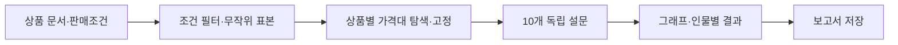
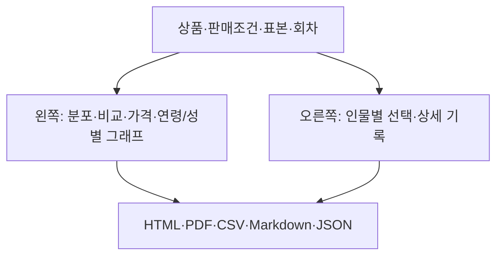

# Paneloom · 패널룸

**전용 결정 모델로 상품 설문을 실행할 수 있는지 검증하는 macOS 앱입니다.**
현재 버전은 **0.8.1 · 빌드 9**입니다. 소비자 예측 정확도와 일반적인 재현성은 입증하지 않았습니다.

이 저장소는 소스와 자원 명세를 제공합니다. 설치 앱·모델·추론 실행 파일·10,000명 데이터 파일은 포함하지 않습니다.
빌드 방법은 [개발 환경과 빌드](docs/BUILD.md)를 보세요.

## 목표 1. 상품과 조건을 직접 작성한다

- 상품 1~5개를 입력합니다. 상품을 추가하면 같은 표본으로 비교합니다.
- 상품 문서는 Markdown으로 작성합니다. 수정 영역에서 서식을 바로 적용합니다.
- 상품명·판매가격·통화·결제 주기는 별도 필드에 입력합니다.
- 적정가격대는 상품마다 자동으로 탐색합니다. 필요하면 수동 설정에서 경계값 3개를 입력합니다.
- 상품·대상·실행 설정을 한 화면에서 작성합니다. 실행을 시작하면 같은 화면에 결과가 자동으로 쌓이며, 상품과 당시 조건은 펼쳐 확인합니다.

판매가격이 없으면 제시 조건 선택만 실행하지 않습니다.
자동 탐색에서 평가 구간을 확정하지 못하면 적정가격 평가만 실행하지 않고 사유를 남깁니다.
수동 설정의 경계값을 모두 비우면 적정가격 평가만 실행하지 않습니다.
무료 상품도 사용하지 않거나 선택을 보류할 수 있습니다.

## 목표 2. 같은 표본에 독립적인 질문을 한다

지역·나이·성별·프로필 검색으로 대상을 좁힙니다.
기본 100명을 무작위로 추출하며 인원을 바꿀 수 있습니다.
조건에 맞는 사람이 더 적으면 그 인원만 선택합니다. 후보 목록은 표시하지 않습니다.
실행할 때 UUID 목록을 고정해 상품 비교·반복·재개에 사용합니다.

| 평가 영역 | 질문 |
| --- | --- |
| 필요와 이해 | 문제 관련성, 현재 해결 수준, 설명 명확성 |
| 가치와 도입 | 개선 효익, 차별성, 주장 신뢰성, 전환 부담 |
| 의향과 가격 | 사용 의향, 적정가격 인식, 제시 조건 선택 |

Clef-Flash의 전용 선택 경로가 허용된 선택지 중 하나를 반환합니다.
각 질문은 상품·인물 원문에서 독립적으로 판단합니다. 다른 질문의 답은 전달하지 않습니다.
판매가격은 제시 조건 선택에만 사용합니다. 가격대 탐색과 적정가격 평가에는 전달하지 않습니다.
자동 탐색은 소수의 고정 인물에게 넓은 구간을 제시한 뒤 범위를 조정합니다.
코드가 상품별 네 구간을 확정하고 Clef는 제시된 선택지 중 하나만 고릅니다.
본 설문·반복·재개는 확정된 구간을 사용합니다. 탐색 응답은 본 설문 집계에 포함하지 않습니다.
판단 불가·해당 없음·미실시·오류는 구분합니다.

## 목표 3. 결과의 조건과 분포를 함께 본다

결과 화면에서 당시 상품 원문과 실행 조건을 펼쳐 볼 수 있습니다.
실행 조건에는 가격대의 자동·수동 설정과 실제 금액 구간도 표시합니다.
보고서는 저장된 결과와 선택한 회차로 만듭니다. 보고서 생성에 모델을 호출하지 않습니다.
상품 비교·문항별 분포·사용 의향과 조건 선택의 교차표·집단별 가격대·원문을 포함합니다.
상품 조건이 같고 가격만 다르면 실제 관측한 가격점을 표시합니다.
JSON에는 실제 요청·응답·실패·재시도 기록도 남깁니다.
상품마다 가격대가 다를 수 있습니다. 같은 구간 번호도 금액이 같다는 뜻은 아닙니다.

## 확인 범위와 한계

- 데이터는 NVIDIA Nemotron Personas Japan의 연속 10,000행입니다. 전체 모집단의 대표 표본이 아닙니다.
- 모델의 선택 점수는 사람의 구매 확률이 아닙니다. 적정가격대는 구매 상한이 아닙니다.
- 자동 탐색은 평가 범위를 조정합니다. 제품별 가격 판단의 정확도를 입증하지는 않습니다.
- 0.8.0 검사에서 같은 입력 9쌍 중 8쌍의 선택이 같았습니다. 전환 부담은 서로 다른 선택을 반환했습니다.
- 실제 소비자 응답의 정확도·수요·매출 예측은 검증하지 않았습니다.
- Apple Silicon·macOS 14 이상을 대상으로 합니다. 실제 macOS 14와 한글 IME 조합 입력은 미검증입니다.
- 공개 배포용 개발자 서명과 공증은 적용하지 않았습니다.

0.8.1은 현재 Clef 가중치만 사용합니다.
이전 Qwen 결과의 열람·내보내기·복제는 유지하며 재개·재실행은 지원하지 않습니다.
기존 Clef 실행은 원래 질문 계약으로 재개합니다.
검증 범위와 실패 기록은 [구현·검증 기록](docs/IMPLEMENTATION.md)에 있습니다. 원시 검증 산출물은 로컬에 보존하며 Git에 포함하지 않습니다.

## 문서

| 문서 | 내용 |
| --- | --- |
| [제품 목표](PRODUCT.md) | 범위와 제품 원칙 |
| [디자인 규칙](DESIGN.md) | 로고·색상·화면·보고서 규칙 |
| [가격대 테스트 문서](examples/products/price-range/) | 문구류부터 승용차까지 상품 문서 5개 |
| [변경 기록](CHANGELOG.md) | 현재 버전과 이전 개발 단계 |
| [개발 환경과 빌드](docs/BUILD.md) | 필수 자원·준비·빌드 |
| [구현·검증 기록](docs/IMPLEMENTATION.md) | 구조·검사·관측한 한계 |
| [초기 데모](demo/README.md) | 이전 데모 소스 |
| [조사 보관 색인](docs/archive/README.md) | 이전 설계·모델 검토 |

실험 설계와 사람 응답 비교 연구는 [BIWA 위키](https://wiki.biwa.dedyn.io/#personal-wiki/persona-lab-experiment-design)에서 관리합니다.
프로젝트 자체 소스의 라이선스는 아직 지정하지 않았습니다.
외부 자원의 출처와 라이선스는 [자원 라이선스](assets/licenses/README.md)와 [데이터 귀속](assets/data/ATTRIBUTION.md)을 보세요.
