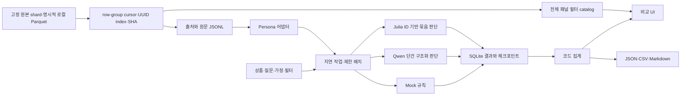

# 구현 계획

기준: [BIWA 기획 r1](https://wiki.biwa.dedyn.io/#personal-wiki/persona-product-simulator-plan)을 직접 읽고, 사용자의 ‘기본 기능이 연결된 1차 데모까지 계속 진행’ 요청을 반영했다. 이 파일은 원문이 아니라 구현 계획이다. 로컬 작업 폴더를 만들었으며 Codex 앱 전역 프로젝트 등록 API는 제공되지 않아 UI 등록 완료로 보고하지 않는다.

## 지금 구현한 경로

원본 수, 필터 대상 수, 판단 작업 수, 배치 크기를 구분한다. UI 페이징을 실험 인원 제한으로 사용하지 않는다. mock·Qwen·Julia의 실제 로컬 경로를 표시하며 결정 백엔드가 보고서를 생성하지 않는다. 공개 Viewer 소형/원본 Parquet 가져오기, 출처·결측 검사, A/B, 실행·취소·재개·저장·비교·내보내기가 이어진다. 원본 첫 shard125,000행·자체100,000행 input proof와 Viewer53명 모델 실측을 구분한다.

## 다음 구현 순서

1. IAB가 연결되면 데스크톱·좁은 화면의 실제 브라우저 렌더링, 키보드·포커스·다운로드·취소/재개를 검증한다. 현재 DOM/API 검증과 시각 검증을 구분한다.
2. 완료한 Parquet 입력의 row-group cursor·checksum·disk catalog를 바탕으로 일반 실험의 재개 스캔 비용과 분할 결과 저장을 개선한다. PyArrow는 프로젝트 `.venv-data`에 선택 설치했고 원본 첫 shard만 검증했다. 전체8shard/분산 실행/백만 인물 추론은 후속 별도 실측이다.
3. 데이터 양·질문·입력 길이·장비별 처리량·RSS·디스크·유효 응답률·복구 시간을 실측한다. 100만 명 실행 시간은 실측 후 추정으로 제시한다.
4. 연결된 Julia·Qwen·mock의 비교 평가를 확대한다. 소형 대비·옵션순서 교체·예산 경고는 초기 실행을 완료했다. 일본어 속성 준수·예산 충돌·질문/선택지 순서 민감도·unknown 사용·모델 변경을 평가한다. 결과를 불리하다고 제거하지 않는다.
5. 단계 순서와 상태를 유지하는 온보딩/사용 후 여정, 정보량별 보고서, 대표성 설명·선택 표본·명시 가중치를 추가한다.
6. 실제 런타임 호환성을 확인한 뒤 Tauri 또는 얇은 셸과 OS별 설치 패키지를 정한다. 코드·fixture·데이터·모델 배포 조건을 각각 확정한다.

외부 유료 API는 키·전송·비용/한도에 대한 사용자 설정을 받기 전에는 활성화하지 않는다. 후속 사용자 승인으로 `KimEJ/persona-lab` 비공개 저장소 생성·소스 push를 진행한다. 모델·원문데이터·실행기록·비밀값은 제외하며 공개 배포·권한 확대는 범위에 없다. 대규모 분산 실행, 사회 영향 실험, 자유 보고서 모델은 기본 경로 검증 이후다.
