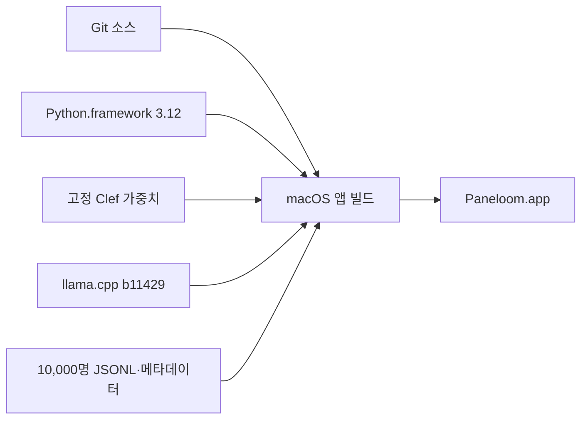

# 개발 환경과 빌드



0.8.1 · 빌드 9는 Apple Silicon·macOS 14 이상을 대상으로 합니다.
앱은 Python·모델·데이터·추론 실행 파일을 포함합니다.
Git 소스만 내려받으면 바로 실행되지 않습니다. 아래 자원을 먼저 준비하세요.
프로젝트의 Python 패키지 의존성은 없습니다.

## 1. 빌드 환경을 준비한다

- Apple Silicon Mac
- Xcode 명령행 도구: `xcrun swiftc`, `install_name_tool`, `otool`, `codesign`
- Python.framework 3.12 배포본
- 모델과 앱을 저장할 여유 공간

빌드에는 macOS의 Python.framework 3.12를 사용하세요.
`tools/build.py`는 실행 중인 Python의 기본 경로에서 `Python`, `lib/`, `Resources/`를 복사합니다.
Homebrew Python이나 프레임워크가 없는 Python 배포본은 이 절차의 대상이 아닙니다.
Python 설치 안내는 [Python 공식 macOS 배포 페이지](https://www.python.org/downloads/macos/)를 보세요.

저장소 루트에서 작업합니다.

```sh
git clone https://github.com/KimEJ/persona-lab.git
cd persona-lab
```

## 2. 현재 모델을 준비한다

명세는 [`assets/model.json`](../assets/model.json)에 있습니다.
공식 [ggml-org Clef-Flash GGUF 저장소](https://huggingface.co/ggml-org/Clef-Flash-GGUF)에서 다음 파일을 준비하세요.

| 항목 | 값 |
| --- | --- |
| 파일 | `Clef-Flash-Q4_K_M.gguf` |
| 대상 경로 | `assets/models/Clef-Flash-Q4_K_M.gguf` |
| GGUF 저장소 리비전 | `4a192915ef971886004b5b13294f2b4c7a7fc39d` |
| SHA-256 | `fd3e90605e8103307dca37cb5a8cdb036267e2fe3cb2d908d80a8ceb9ec0638c` |
| 로컬 파일 크기 | 6,486,448,288바이트 |
| 라이선스 | Apache-2.0 |

[고정한 리비전의 모델 파일](https://huggingface.co/ggml-org/Clef-Flash-GGUF/blob/4a192915ef971886004b5b13294f2b4c7a7fc39d/Clef-Flash-Q4_K_M.gguf)을 내려받아 대상 경로에 둡니다.
파일의 SHA-256을 명세와 비교하세요.

```sh
shasum -a 256 assets/models/Clef-Flash-Q4_K_M.gguf
```

앱은 모델을 시작할 때 SHA-256을 확인합니다.
빌드는 현재 명세가 지정한 가중치 하나만 복사합니다. 이전 Qwen 가중치는 필요하지 않습니다.
Cloudflare 원본 리비전과 GGUF 리비전은 별도로 기록합니다. 원본 리비전이 해당 GGUF의 변환 입력이라는 증거는 아닙니다.

## 3. 추론 실행 파일을 준비한다

[`assets/model.json`](../assets/model.json)에 지정한 **llama.cpp b11429**의 macOS arm64 배포본을 사용합니다.
런타임 소스 리비전은 `d81235049384534c167caea52b85a694f6103d14`입니다.
공식 [llama.cpp b11429 릴리스](https://github.com/ggml-org/llama.cpp/releases/tag/b11429)의 [macOS arm64 배포본](https://github.com/ggml-org/llama.cpp/releases/download/b11429/llama-b11429-bin-macos-arm64.tar.gz)을 준비하세요.
공식 릴리스 API에 표시된 배포본 SHA-256은 `740288ec6887be94280a5dfa25b5e23a78285cab104519e6c7e218904ee82459`입니다.

`assets/runtime/`에 실행 가능한 `llama-server`와 같은 배포본의 동반 라이브러리를 둡니다.
라이브러리 파일과 심볼릭 링크를 유지하세요. 서버 파일 하나만 복사하면 실행에 필요한 라이브러리가 누락될 수 있습니다.
Clef 전용 `/v1/systemone` 경로가 있는 버전이 필요합니다.
준비·다운로드·소스 컴파일은 `tools/build.py`가 수행하지 않습니다.

현재 명세의 `runtime_policy: metal-fusion-off-v1`을 유지하세요. 앱은 모델 자식 프로세스에 `GGML_METAL_FUSION_DISABLE=1`을 설정합니다.
b11429의 Metal 행렬곱·덧셈 결합이 Clef의 점수를 잘못 계산하는 문제를 피합니다. GPU 실행은 유지합니다.
원인과 upstream 수정은 [llama.cpp #30100](https://github.com/ggml-org/llama.cpp/pull/30100)에 있습니다.
실행 지문에 이 정책을 포함하므로 수정 전 결과와 새 추론을 섞어 재개하지 않습니다.

## 4. 인물 데이터를 준비한다

현재 활성 명세는 [`assets/data/nemotron-japan-sample.json`](../assets/data/nemotron-japan-sample.json)입니다.
Git에는 10,000명 풀의 JSONL을 포함하지 않습니다.
이전 실행과 준비 도구에 필요한 고정 53명 합성 샘플·메타데이터는 포함합니다.

| 자원 | 경로 | SHA-256 |
| --- | --- | --- |
| 현재 10,000명 풀 | `assets/data/nemotron-japan-pool-10000.jsonl` | `d8d8b45a7f513104183428c64b3a8301c719aded564ab5bf578a12181a0f6c3d` |
| 고정 53명 샘플 | `assets/data/nemotron-japan-sample.jsonl` | `826d6afc3b33ada62445f3fe5bb0db38dce7719a32d826f9758018e4a35fbcb2` |

기존 자원이 있으면 활성 명세와 일치하는 10,000명 JSONL을 대상 경로에 둡니다.
새로 준비하려면 다음 도구를 실행합니다. 공식 Hugging Face API에 네트워크로 접근합니다.

```sh
python3 tools/prepare_persona_pool.py --count 10000
```

이 도구는 고정 53명 샘플의 존재와 SHA-256을 먼저 확인합니다.
공식 Viewer에서 완전한 행만 가져오고 UUID 중복·필드 누락·잘린 값을 검사합니다.
성공하면 JSONL과 활성 메타데이터를 저장하고 `verification/persona-pool.json`에 준비 기록을 남깁니다.
다른 내용의 기존 풀은 덮어쓰지 않습니다.

Viewer API의 `main`은 바뀔 수 있습니다. 다시 받은 파일이 위 SHA-256과 같다고 보장하지 않습니다.
다른 파일과 함께 갱신한 메타데이터를 사용하면 새로운 데이터 버전으로 실행합니다.
별도로 관측한 원본 저장소 리비전은 API 행을 그 리비전에 고정하지 않습니다.
10,000명은 연속 구간이며 전체 모집단의 대표 표본이 아닙니다.
라이선스와 귀속은 [데이터 귀속 문서](../assets/data/ATTRIBUTION.md)를 유지하세요.

## 5. 앱을 빌드한다

Python.framework 3.12의 실행 파일로 빌드합니다.

```sh
/Library/Frameworks/Python.framework/Versions/3.12/bin/python3.12 tools/build.py \
  --output 'build/releases/survey-report/Paneloom.app'
```

출력 경로에 앱이 있으면 빌드가 해당 앱을 교체합니다.
빌드는 소스·웹 화면·자원을 복사하고 Swift 실행 파일을 만듭니다.
Python의 외부 `site-packages`는 포함하지 않습니다.
로컬 서명 검사와 번들 Python의 필수 모듈 import를 확인합니다. 실제 모델 추론은 실행하지 않습니다.
빌드 성공은 실행 파일·데이터·모델 조합의 전체 동작 검증을 뜻하지 않습니다.

ZIP이 필요하면 `--zip`을 추가합니다.

```sh
/Library/Frameworks/Python.framework/Versions/3.12/bin/python3.12 tools/build.py \
  --output 'build/releases/survey-report/Paneloom.app' --zip
```

기본 ZIP 경로는 `dist/Paneloom-0.8.1-macOS-arm64.zip`입니다.
현재 GitHub 소스 기록에는 앱이나 ZIP이 없습니다.
빌드는 로컬 임시 서명을 사용합니다. 공개 배포용 개발자 서명과 공증은 별도 작업입니다.

## 6. 실행과 기록 위치를 확인한다

빌드한 `Paneloom.app`을 엽니다.
앱은 로컬 서비스와 전용 모델 프로세스를 실행합니다.
상품 입력·실험 DB·스냅샷·로그는 `~/Library/Application Support/Persona Lab/`에 저장합니다.
기존 실험을 계속 읽도록 저장 경로와 내부 식별자는 유지합니다.
이 기록은 Git에 포함하지 않습니다.

기능의 확인 범위와 알려진 실패는 [구현·검증 기록](IMPLEMENTATION.md)을 보세요.
