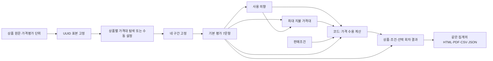
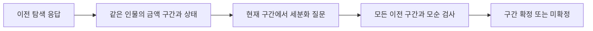

# Persona Lab 구현·검증 기록

0.8.1은 현재 Clef 가중치만 포함한다. 설문·보고서 흐름은 0.8.0에서 유지한다.
새 질문 계약은 `product-survey-v4`다. 새 실행에는 `inference_protocol: survey-staged-v1`을 기록한다. Clef 모델·로컬 llama.cpp b11429는 유지한다.
구현과 실행 정확도를 구분한다. 실험 설계·사람 응답 비교 연구는 [BIWA](https://wiki.biwa.dedyn.io/#personal-wiki/persona-lab-experiment-design)에 둔다.

## 목표 1: 분석 항목을 유지하며 판단을 연결하고 단계별 저장

| 순서 | 문항 |
| --- | --- |
| 1 | 문제 관련성 |
| 2 | 현재 해결 수준 |
| 3 | 설명 명확성 |
| 4 | 개선 효익 |
| 5 | 차별성 |
| 6 | 주장 신뢰성 |
| 7 | 전환 부담 |
| 8 | 사용 의향 |
| 9 | 최대 지불 의향 가격대 |

한 인물·상품·회차에서 1~7번 문항을 한 요청에 함께 넣는다. 다음 요청은 저장한 7개 답으로 사용 의향을 판단한다. 마지막 요청은 그 답과 사용 의향으로 최대 지불 가격대를 판단한다. 최종 선택 모델 요청은 없다.
본 설문의 주 호출은 3회다. 평가 구간이 없으면 2회다. 판매가격은 호출 수를 바꾸지 않는다.
가격대 탐색과 판단 불가 사유 분류는 이 횟수에 포함하지 않는다.
상품 평가에는 가격 구간과 판매조건을 넣지 않는다. 최대 지불 가격대에만 고정 구간을 넣는다. 모델에 실제 판매조건은 넣지 않는다.
선행 답은 `survey-history-v1`로 전달한다. 같은 인물·상품·회차의 선택 코드·뜻·상태·판단 불가 정보를 사용한다. 원문 사실·탐색 응답·다른 상품과 회차의 답을 합치지 않는다. 기본 7문항은 함께 판단하며 사용 의향과 최대 지불 가격대는 선행 답에 조건화한다. 이전 독립 평가와 같은 결과를 보장하지 않는다.
실행 스냅샷과 백엔드 지문으로 묶음 평가를 구분한다. 기존 실행·준비 스냅샷에는 새 방식을 덧붙이지 않는다.
기본 7문항·사용 의향·최대 지불 가격대를 각각 검증·저장한 뒤 다음 단계를 호출한다. 공유 요청은 각 문항에 연결한다. 각 응답에 선행 답과 히스토리 지문을 기록하고 의존 요청 식별자에 포함한다.
기본 평가의 실패 항목을 재시도할 때도 원래 7문항 구성을 전달하며 성공한 다른 기본 결과는 바꾸지 않는다. 선행 답이 바뀌면 후속 결과를 무효화하고 새 히스토리로 다시 평가한다. 이전 응답은 별도 이력에 보존하며 실제 호출 연결도 남긴다. 중단 후에는 저장한 단계부터 재개한다. 선행 실행 오류는 후속 단계를 보류한다. 판단 불가·미실시를 실행 오류로 바꾸지 않는다.
모델 입력 한도를 넘으면 실행 전에 안내한다. 상품 원문을 자르거나 분석 항목을 생략하지 않는다.
기존 v1·v2·v3 실행은 원래 질문·정책·요청 식별자로 재개한다. 새 실험과 복제·가져오기에는 v4를 사용한다.
모든 모델 질문에서 별도 가격·명시적인 가격 줄을 제외한다. 간접 암시 제거에는 한계가 있다.
정확한 금액·설명·실제 경험·인지 상태를 생성하지 않는다.

중간 선택은 판단 불가가 아니다. 해당 없음은 문항이 적용되지 않는 근거가 있을 때만 사용한다.
정보 부족은 `unknown`, 적용 불가는 `not_applicable`, 실행하지 않은 문항은 `not_run`으로 구분한다.
선택 점수는 모델 내부 분포다. 사람의 구매 확률이나 보정된 확신도가 아니다.
판단 불가의 부족 정보는 별도 유한 선택으로 분류한다. 상품 평가에서 판단 불가인 문항들의 분류는 한 요청으로 묶는다. 추가 분류 실패 시 주 판단·점수를 보존하고 오류만 별도로 남긴다.

앞선 v3 검사는 모의 SystemOne 응답으로 2회 주 호출·9문항과 이전 v2 계약 보존을 확인했다. v4는 집중 Python 검사 9개와 UI 검사 1개로 7→1→1 주 호출, 히스토리 0→7→8개, 단계 중단·재개, 오류 차단·후속 무효화·원응답 보존, 자동 탐색 분리, 기존 v3 스냅샷과 가져오기를 확인했다. 엄격한 프로토콜 검사와 재시도 중단 화면 수정은 해당 검사만 다시 확인했다. 실제 모델 호출은 추가하지 않았다.
문항별 오류·판단 불가 분류 실패·공유 요청 조회·중단과 재개·실패 항목 재시도·기존 계약 재개·보고서 집계를 검사한다.
진행 중인 사용자 실험을 유지하기 위해 실제 모델 추론과 속도 비교는 추가로 실행하지 않았다.

## 목표 2: 입력과 실행 조건을 명시

새 문서 양식은 해결할 문제·기능·대안과의 차이·효익의 근거·사용 방법·도입 조건·자료/권한 조건을 포함한다.
상품명·판매가격은 별도 필드다. 문서는 20,000자까지 저장하고 원문·되돌리기를 유지한다.
상단 단계 표시는 현재 위치만 알린다. 아이템 1~5개와 입력·다음·실행·결과 흐름을 유지한다.

최대 지불 가격대는 통화·결제 주기를 지정하고 자동 탐색을 기본으로 한다.
준비 단계는 소수의 고정 인물에게 넓은 구간을 제시하고 범위를 제한적으로 조정한다.
판매가격은 탐색에 전달하지 않는다. 코드는 구간을 만들고 모델은 허용된 선택지만 반환한다.
상품별 네 구간을 확정한 뒤 본 설문을 시작한다. 마지막 구간은 상한이 없다.
탐색의 유효 응답이 부족하면 최대 지불 가격대만 미실시로 남기고 구체적인 사유를 보존한다.
탐색 부족은 개별 인물의 판단 불가나 본 설문의 실행 오류와 구분한다.

| 탐색 규칙 | 제한 |
| --- | --- |
| 탐색 인물 | 필터에 맞는 최대 12명. 본 설문 밖의 인물을 우선하며 겹친 인원은 기록한다. 입력·소스·seed로 순서를 고정한다. |
| 초기 경계값 | JPY: 100/10,000/1,000,000, KRW: 1,000/100,000/10,000,000, USD·EUR: 1/100/10,000. 시장 적정가가 아닌 넓은 시작 구간이다. |
| 결제 주기 | 월간은 초기 경계값을 1/10로 줄인다. 연간과 일시불은 같은 시작값을 사용한다. 통화 환산이나 연간 가격 추정은 하지 않는다. |
| 유효 응답 | 회차마다 최소 4명이며 탐색 인원의 절반 이상이어야 한다. 판단 불가·오류는 범위 계산에서 제외한다. |
| 범위 조정 | 유효 응답의 75% 이상이 끝 구간을 고르면 범위를 100배 확대 또는 축소한다. 유한 구간에 몰리면 해당 구간의 기하 중간값으로 세분화할 수 있다. |
| 이전 결정 | 새 `auto-wtp-v3`는 같은 인물의 선행 회차를 `price-calibration-history-v1`로 전달한다. 성공 응답은 실제 금액 구간·통화·결제 주기를 사용한다. 판단 불가·오류는 상태만 전달한다. |
| 왕복·모순 방지 | `auto-wtp-v3`·`auto-wtp-v2`·`auto-price-v3`는 이미 평가한 경계값을 다시 요청하지 않는다. 각 인물의 선택 구간을 모든 선행 회차와 비교한다. 한 명이라도 구간이 겹치지 않으면 인물 식별자·선행 회차·모순 수·사유를 기록하고 미확정으로 종료한다. 이 검사는 75% 집중 조건과 분리한다. |
| 최대 호출 | 상품 원문·이름·평가 단위가 같은 입력당 최대 4회차·48개 주 판단. 한도에서 끝 구간 쏠림이 계속되면 미실시로 남긴다. |

수동 설정에서는 경계값 3개를 입력한다. 세 값은 0보다 크고 오름차순이어야 한다.
모두 비우면 최대 지불 가격대만 미실시다. 일부 입력·잘못된 순서·정밀도는 저장·실행을 막는다.
설정 모드가 없는 기존 입력은 수동으로 읽으며 기존 결과와 고정 구간을 바꾸지 않는다.
탐색 중에는 별도 준비 기록을 저장하고 완료한 응답은 재사용한다.
확정 구간·탐색 표본·원시 응답·알고리즘 버전을 실행 스냅샷에 남긴다.
본 설문·반복·재개에서 구간을 다시 탐색하지 않는다. 탐색 응답은 본 설문 집계에서 제외한다.
기존 `auto-wtp-v2`·`auto-wtp-v1`·`auto-price-v3`·`auto-price-v2`·`auto-price-v1` 준비 상태는 저장한 알고리즘과 요청 식별자로 재개한다. 이전 방식에는 결정 히스토리를 추가하지 않는다. 완료한 구간과 원응답을 재판정하지 않는다. 새 방식으로 다시 평가하려면 실험을 복제한다.
판매가격만 다른 동일 입력은 같은 확정 구간을 재사용한다.
판매가격 미입력은 가격 수용 계산을 미실시로 둔다. 사용 의향이 없으면 판매가격 없이도 비수용으로 계산한다.
최대 지불 가격대는 최대 금액이 속한 구간이다. 통화·결제 주기를 환산하지 않는다.

가격 수용은 `usage_and_max_willingness_to_pay_v1` 규칙으로 계산한다. 의향 없음은 비수용이다. 무료에서 의향 있음은 수용, 고려는 보류다. 유료에서 판매가격이 지불상한 구간의 하한 이하면 수용 가능하고, 유한 상한보다 높으면 비수용이다. 구간 안에 있으면 실제 상한을 알 수 없어 판정 불가다. 고려 응답은 가격 조건이 맞아도 보류다. 필요한 응답의 판단 불가·오류·대기·미실시와 단위 불일치를 분리한다. 계산 결과에는 원래 평가 job ID와 적용 규칙을 남기며 모델 점수를 만들지 않는다.

대상은 NVIDIA 원본 API의 10,000개 연속 행 풀에서 검색·지역·나이·성별로 거른다.
기본 100명을 무작위 추출하고 조건 일치 수가 적으면 그 수만 선택한다. 다시 추출은 seed를 바꾼다.
원본 22개 필드·로컬 지문을 보존하고 실행 시 UUID 목록을 고정한다.
아이템 비교·반복·재개는 같은 UUID 순서를 사용한다. 후보 목록은 표시하지 않는다.
이 풀은 전체 100만 명의 대표 표본이 아니며 저장한 필드와 모델 입력 범위는 별도다.

## 목표 3: 결과에서 문맥을 유지하고 독립 보고서 저장

결과 상단은 상품 선택과 접힌 상품·실험 조건을 표시한다.
펼치면 당시 상품 원문·판매조건·표본과 적용한 필터를 확인한다. 중복 요약·인물 목록 위 상품 설명·기술 메타데이터는 표시하지 않는다. 그래프 범례·단위·미실시와 오류 사유를 유지하고 전체 실행 조건은 JSON 보고서에 보존한다.
이전 화면으로 이동하지 않고 조건을 읽으며 왼쪽 그래프·오른쪽 인물 상세를 유지한다.

보고서는 SQLite의 한 읽기 스냅샷에서 고정 표본·선택 회차의 집계를 가져온다.
화면·HTML·PDF·CSV·JSON은 같은 질문별 분모·선택 수·비율을 사용한다. 회차는 합산하지 않는다.
판단 불가·해당 없음·미실시·오류·대기를 분리하고 비교표에는 비교·제외 인원을 남긴다.
검토 메모는 원래 판단과 분리한다. JSON은 원시 호출 기록도 포함한다.
최대 지불 가격대 전이는 두 상품의 실제 구간·통화·결제 주기를 함께 보존한다.
구간이 다르면 같은 `price_1`도 같은 금액을 뜻하지 않는다. 번호로 가격 증감을 추론하지 않는다.
가격만 다른 관측점은 실제 평가 구간과 단위까지 같은 상품끼리만 묶는다.
CSV에는 최대 지불 가격대의 자동/수동 설정·탐색 상태·금액 경계를, JSON에는 별도 탐색 기록을 포함한다.

| 보고서 부분 | 내용 |
| --- | --- |
| 상품 | 첫 페이지에 상품명·렌더링한 Markdown 원문. 같은 원문은 한 번만 표시 |
| 개요 | 다음 페이지에 사용 의향·최다 지불 가격대·입력한 판매가격의 수용. 적용 필터·여러 회차의 선택 회차만 표시 |
| 비교 | 같은 인물·회차의 상품별 선택과 전이 |
| 기본 평가·사용·가격 | 개요 뒤에 문항별 그래프, 지불 가격 분포와 코드로 계산한 가격 수용 |
| 가격 | 상품 조건이 같고 가격만 다른 실제 관측점 |
| 집단 | 연령·성별 가격 분포와 분모 |
| 확인할 응답 | 오류·판단 불가·미실시 사유가 있는 사례 최대 3명. 자료 귀속·라이선스 유지 |

HTML은 스타일·그래프를 포함한 단독 파일이다. 보고서 생성에 모델을 호출하지 않는다.
상단 실행일·시간대·완료 상태·기본 1/1회차·관찰 목록·중복 상품 요약·기술 메타데이터를 표시하지 않는다.
전체 실행 조건과 문항·원문·원시 기록은 JSON에 보존한다. 긴 상품 설명은 축약하지 않고 페이지를 이어 둔다.
네이티브 PDF는 같은 HTML을 네트워크·JavaScript 없이 렌더링하고 macOS 인쇄 경로로 A4 페이지를 나눈다.
PDF 저장은 임시 파일을 검증한 뒤 원자적으로 완료한다. 실제 페이지와 내보내기 검증은 아래 영수증 범위로 기록한다.
교차표는 인과 설명이 아니며 가격 관측점으로 수요·매출을 외삽하지 않는다.
자동 탐색의 가격 판단 정확도와 실제 소비자 적합성은 검증하지 않았다.

## 가격 질문 안정화 검토

현재 Clef는 선택지 전체를 공동 평가한다. 가격 구간을 바꾸면 같은 인물의 지불상한 선택도 달라질 수 있다. 개인별 모순 검사로 잘못된 범위 확정을 막지만 모델의 가격 판단을 보정하지는 않는다. [공식 모델 구조](https://huggingface.co/Cloudflare/clef-flash#model)

가격 탐색은 아래 흐름을 사용한다. 탐색 히스토리는 본 설문의 3단계 응답 히스토리와 별도로 보존한다.

히스토리는 해당 인물의 모델 판단이며 인물의 사실로 취급하지 않는다. 근거가 부족하거나 이전 구간 밖으로 판단을 수정해야 하면 판단 불가를 허용한다. 선택지를 제한하거나 원응답을 보정하지 않는다. 모순된 구간을 고르면 기존 코드 검사로 미확정 처리한다. 실제 판매가격·다른 인물의 응답·본 설문 답은 전달하지 않는다. 최초 결정의 오류를 반복할 수 있으므로 일관성과 가격 정확도는 별도로 평가한다.

새 요청 식별자에는 히스토리 내용과 프로토콜을 포함한다. 준비 기록에 전달한 히스토리를 저장하고 원시 요청도 기존 호출 기록에 남긴다. 취소·재개는 저장한 응답에서 같은 요청을 복원한다.

기존 반전 사례 한 명의 세분화 요청을 히스토리 없이·포함해서 각 1회 비교했다. 두 요청 모두 이전 `100–9,999 JPY`와 겹치지 않는 `100 JPY 미만`을 선택했다. 이 사례에서 히스토리만으로 반전을 해결하지 못했다. 코드는 해당 응답을 모순으로 검출해 구간을 확정하지 않는다. 원시 비교 기록은 `build/wtp-check/range-cause/history-probe.json`에 저장했다. 전달·재개·기존 방식 보존·본 설문 격리의 집중 테스트 9개가 통과했다. 원래 실험 파일은 바꾸지 않았다.

히스토리 질문에서 판단 불가를 선택하면 기존 후속 진단은 누락 정보만 분류한다. 이전 추정을 수정해야 하는 사유를 별도 항목으로 분류하지는 않는다.

다른 질문 방식은 아래 후보로 남긴다. 아직 구현하지 않았다.

| 변경안 | 인물·상품당 주 호출 | 판단 |
| --- | --- | --- |
| 금액 하나씩 독립 질문 | 기본 평가·사용 의향 2회 + 가격 경계 3회 = 5회 | 우선 검증안. 동일한 질문·수용/거절/판단 불가 선택지를 유지하고 검사 금액만 바꾼다. 다른 가격 선택지의 영향을 제거하지만 가격 간 단조성과 정확성을 별도로 확인해야 한다. |
| 경계별 질문 3개를 한 요청에 묶기 | 기본 평가·사용 의향 2회 + 가격 평가 1회 = 3회 | 속도 유지안. 코드가 답을 구간으로 변환하고 낮은 금액 거절·높은 금액 수용을 검출한다. 공동 평가 구조가 질문 간 영향을 남길 수 있다. |
| 상품별 공통 구간 고정 | 3회 | 임시안. 탐색 중 구간 변경을 줄이지만 최초 구간 의존성과 가격 판단 문제는 남는다. |

검사 금액은 실제 판매가격과 별도 필드로 둔다. 기본 7문항과 사용 의향에는 금액을 넣지 않는다. 가격 질문에는 검사 금액·통화·결제 주기만 더하고 근거가 부족하면 판단 불가를 허용한다. 판단 불가를 거절로 바꾸거나 원응답을 다수결로 보정하지 않는다.

독립 질문의 최소 검증 후보는 기존 반전 사례의 인물 한 명에게 100·300·1,000 JPY를 같은 선택지로 각각 묻는 3회다. 낮은 금액을 거절하면서 높은 금액을 수용하는지 확인한다. 이진 탐색은 호출을 줄일 수 있지만 두 답만으로 가격 간 일관성을 검증할 수 없다.

## 보존과 정리

같은 런타임의 기존 Clef 3단계·v1 8문항·10문항 실행은 원래 계약·소스로 재개한다. Metal 오류 수정 전 런타임의 결과는 보존하며 복제 후 새로 실행한다.
이전 Qwen 결과는 열람·내보내기·복제를 유지하지만 재개·재실행은 명시적인 오류로 차단한다.
이전 모델 호환 로딩·자동 다운로드·다른 모델 대체는 하지 않는다.
모든 DB·인물 자료·원시 호출·실패 증거·모델 명세·라이선스는 보존한다. 새 의존성·커밋은 추가하지 않는다.
사용자의 이전 모델·캐시 삭제 요청에 따라 가중치 보관 정책을 바꿨다. 이전 Qwen·후보·중복 준비 가중치·관련 캐시·이전 생성 앱/ZIP을 삭제했다.
빌드는 `assets/model.json`이 지정한 가중치만 복사한다. 다른 가중치가 소스 폴더에 있어도 포함하지 않는다.
원래 사용자 실험을 새 질문이나 모델로 덮어쓰지 않는다.

0.7까지의 구현·검증 표와 과거 조사 문서는 [보관 색인](archive/README.md)에 옮겼다.
[0.7까지의 구현 사본](archive/IMPLEMENTATION-through-0.7.md)과 조사 JSON 값을 보존했다.
재사용 가능한 `tools/probe_reference_adapters.py`는 보관된 소스 명세를 읽는다. 재실행하지 않았다.
모델 준비물 12개 경로의 이동은 과거 기록이며 [작업 보관 색인](../archive/README.md)에 남긴다. 현재 삭제 정책과 구분한다.

0.8.0의 동일 입력 9쌍 중 8쌍의 선택이 같았고 전환 부담은 `not_applicable`/`low`로 달랐다. 관측한 재현성 실패이며 서로 다른 분포를 그대로 보존한다. 원인은 그 실행으로 분리하지 못했다. 과거 Clef의 정당화되는 16개 명시/연결 조건 중 4개 미충족도 유지한다. 두 가격 기대값의 근거 부족·API 옵션 정렬·연결 검사 범위를 구분한다. 일반 결정론·소비자 정확도·보정은 입증하지 않았으며 과거 상세는 보관 사본에 있다.

## 이번 0.8.1 정리 상태

| 범위 | 상태 |
| --- | --- |
| 현재 모델 전용 빌드 | 0.8.1·빌드 9, 6,688,901,403바이트(약 6.69GB). 이전 앱 10,069,287,173바이트에서 감소. 최종 deep/strict 서명·이동 후 번들 Python import 통과 |
| 집중 검사 | 모델 분기 2개·현재 가중치만 묶는 빌드 자원 1개 통과 |
| 기존 결과 | 삭제 후 이전 Qwen v2 결과 53명·159행 열람·HTML 내보내기 통과. 모델 추론 0회 |
| 삭제 | 20개 경로의 이전 앱/ZIP·Qwen·후보·중복 준비 가중치·외부 Julia 가중치와 tokenizer 제거. 이전 서버 4255/4256 종료 |
| 현재 자원·캐시 | 작업 자원·현재 앱의 Clef 두 사본만 남음. Hugging Face·ModelScope·llama.cpp 캐시에 모델 가중치 없음. 무관한 작은 로그·잠금 파일은 유지 |

최종 기록은 `verification/current-model-only.json`에 있다. 이 정리에서 모델을 재실행하지 않았다.
실험 DB·입력 스냅샷·인물 데이터·과거 모델 명세/라이선스·실패 증거는 보존했다.

## 이전 0.8.0 기능 검증 기록

| 범위 | 상태 |
| --- | --- |
| 집중 검사 | 코어 20개(새 6·기존 14)·보고서 3개·통합 3개·표본/이전 재개 3개·이전 원시 감사 1개와 Node VM 통과 |
| 실제 모델 | 1명 × 0/2,000 JPY 조건 × 10문항 = 20판단. 주 판단 20개·추가 분류 1개, 실제 21요청·실행 오류 0개·출력 토큰 0개. `verification/survey-report.json` |
| 독립 입력·문맥 | 가격 제외 입력 9쌍 동일. 20개 모두 선행 답 없음. 고정 문맥·선택 회차 분모 1명 확인 |
| 재현성 | 같은 입력 9쌍 중 선택 일치 8쌍. 전환 부담 불일치와 원시 분포를 보존. 성공으로 판정하지 않음 |
| HTML·집계 | HTML/PDF 변환용 HTML 동일, 화면·CSV·Markdown·JSON 집계 대조 완료. 마지막 가독성 수정 후 실제 최종 번들의 HTML API 성공 |
| 네이티브 PDF | 최종 A4 12페이지·155,746바이트. PDFKit으로 전 페이지의 한국어·SVG 그래프·페이지 나눔 확인. Poppler CMap 자원은 없어 해당 경로로 검증하지 않음 |
| 화면 | 1280×720·900×650에서 상품/조건·10개 상세·도넛 확인. 최소 폭의 문서 폭·scrollWidth 모두 900. 독립 시각 검토 통과 |
| 앱 | 최종 0.8.0 재빌드·로컬 서명·import·번들/작업 파일 26개 일치. 이번 변경은 ZIP을 만들지 않음 |
| 정리 | 원본 사용자 홈 무변경. 소유 서버·모델·탭 종료와 임시 viewport 복원 |

가독성·페이지 수정은 저장한 결과를 다시 렌더링했다. 실제 모델 요청은 21개 그대로이며 추가 호출하지 않았다.
최종 PDF는 `verification/survey-report.pdf`, 영수증은 `verification/survey-report.json`에 있다.
최종 화면은 `.impeccable/review/survey-report-results-final.jpg`, `survey-report-minimum-final.jpg`, `survey-report-context.jpg`에 있다.
UI HTML 다운로드 이벤트는 시간 초과로 관측하지 못했다. 콘솔 오류는 0개였으며 HTML API·네이티브 변환 검증과 구분한다.
실제 소비자 타당성·100명 전체 실행·네이티브 저장 대화상자는 확인하지 않았다. 새 계약에서는 위 재현성 실패를 관측했다.
macOS 14·실제 한글 IME 조합·공개 배포용 서명과 공증은 미검증 또는 미적용이다.

## 2026-10-14: 동일 입력 점수와 가격 탐색 수정

현재 b11429의 Metal `MUL_MAT+ADD` 결합은 Clef 헤드에서 다른 행렬곱을 더할 때 기록되지 않은 버퍼를 참조한다.
고정 소스의 해당 코드와 [upstream 수정 #30100](https://github.com/ggml-org/llama.cpp/pull/30100)을 대조했다. 새 런타임을 내려받지 않고 문제 결합을 끈다.
`assets/model.json`에 `runtime_policy: metal-fusion-off-v1`을 기록한다. 모델 자식 프로세스의 `GGML_METAL_FUSION_DISABLE=1`과 백엔드 지문이 함께 바뀐다. GPU 실행은 유지한다.
수정 전 사용자 기록에서 같은 요청 12쌍 중 4쌍의 선택이 달랐고 점수 차이는 최대 13.34%p였다. 원본 DB·스냅샷을 수정하지 않았다.
수정된 별도 서버에서 7회 요청을 실행했다. 다른 입력을 사이에 넣고 서버를 재시작한 경우를 포함해 같은 요청 A의 5개 응답은 선택·점수가 정확히 일치했다.
짧은 기존 서버 반복에서도 일치한 사례가 있으므로 매 요청이 흔들리는 문제로 단정하지 않는다. 버퍼 배치에 따라 잘못된 점수가 재현되는 upstream 오류와 구분한다.

새 자동 탐색은 `auto-price-v2`다. 같은 경계값을 다시 요청하지 않으며 지배적인 응답 구간이 서로 겹치지 않을 때 같은 인물의 모순된 응답을 기록하고 미확정으로 종료한다.
같은 백엔드의 저장된 v1 탐색은 원래 표본·작업 ID·규칙으로 재개한다. 런타임 지문이 바뀐 기존 실행·준비는 결과를 섞지 않도록 동기적으로 거부하며 복제를 안내한다.

관련 유한 선택·시작 환경·재개·가격 탐색 검사가 통과했다. 별도 4명 데이터·본 표본 1명으로 줄 노트 상품을 실제 실행했다.
가격 탐색은 `100/10,000/1,000,000 → 100/1,000/10,000 JPY` 두 회차·8요청으로 확정했다. 본 설문은 3요청·10항목이며 적정가격과 무료 조건 거절을 포함해 오류 0개였다.
검증 산출물은 로컬 `build/repeatability-check/`에 보존한다. 이 검사는 일반적인 결정론이나 실제 소비자 가격 판단 정확도를 입증하지 않는다.

## 관련 파일

| 범위 | 파일 |
| --- | --- |
| 질문·실행 | `src/persona_lab/survey.py`, `finite_decision.py`, `responses.py`, `scenarios.py`, `contracts.py`, `runner.py` |
| 입력·집계·보고서 | `src/persona_desktop/documents.py`, `application.py`, `results.py`, `reporting.py` |
| 화면·PDF | `web/app.js`, `index.html`, `results.js`, `results.css`, `macos/App.swift` |
| 기록 | `README.md`, `PRODUCT.md`, 이 문서, `docs/archive/`, 참조 프로브의 보관 명세 경로 |
