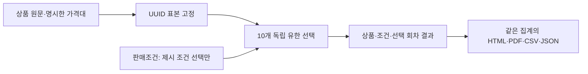

# Persona Lab 구현·검증 기록

0.8.1은 현재 Clef 가중치만 포함한다. 설문·보고서 흐름은 0.8.0에서 유지한다.
새 계약은 `product-survey-v2`·`survey-choice-v2`다. Clef 모델·로컬 llama.cpp b11429는 유지한다.
구현과 실행 정확도를 구분한다. 실험 설계·사람 응답 비교 연구는 [BIWA](https://wiki.biwa.dedyn.io/#personal-wiki/persona-lab-experiment-design)에 둔다.

## 목표 1: 질문을 독립적으로 실행

| 순서 | 문항 |
| --- | --- |
| 1 | 문제 관련성 |
| 2 | 현재 해결 수준 |
| 3 | 설명 명확성 |
| 4 | 개선 효익 |
| 5 | 차별성 |
| 6 | 주장 신뢰성 |
| 7 | 전환 부담 |
| 8 | 사용 의향 |
| 9 | 적정가격 인식 |
| 10 | 제시 조건 선택 |

각 질문은 인물·상품 원문만 받는다. 제시 조건 선택에만 실제 판매조건을 추가한다.
이전 v1의 일곱 선행 선택을 전달하는 연결을 새 계약에 사용하지 않는다.
판매조건 외 질문에서 별도 가격·명시적인 가격 줄을 제외한다. 간접 암시 제거에는 한계가 있다.
정확한 금액·설명·실제 경험·인지 상태를 생성하지 않는다.

중간 선택은 판단 불가가 아니다. 해당 없음은 문항이 적용되지 않는 근거가 있을 때만 사용한다.
정보 부족은 `unknown`, 적용 불가는 `not_applicable`, 실행하지 않은 문항은 `not_run`으로 구분한다.
선택 점수는 모델 내부 분포다. 사람의 구매 확률이나 보정된 확신도가 아니다.
판단 불가의 부족 정보는 별도 유한 선택으로 분류한다. 추가 분류 실패 시 주 판단·점수를 보존하고 오류만 별도로 남긴다.

## 목표 2: 입력과 실행 조건을 명시

새 문서 양식은 해결할 문제·기능·대안과의 차이·효익의 근거·사용 방법·도입 조건·자료/권한 조건을 포함한다.
상품명·판매가격은 별도 필드다. 문서는 20,000자까지 저장하고 원문·되돌리기를 유지한다.
상단 단계 표시는 현재 위치만 알린다. 아이템 1~5개와 입력·다음·실행·결과 흐름을 유지한다.

적정가격은 통화·결제 주기·경계값 3개를 별도로 입력한다.
세 값은 0보다 크고 오름차순이어야 하며 네 구간을 만든다. 마지막 구간은 상한이 없다.
모두 비우면 적정가격만 미실시다. 일부만 입력하거나 순서·정밀도가 잘못되면 저장·실행을 막는다.
판매가격 미입력은 제시 조건 선택만 미실시다. 무료는 알려진 가격이며 거절·보류할 수 있다.
적정가격은 구매 상한이 아니다. 통화·결제 주기를 환산하지 않는다.

대상은 NVIDIA 원본 API의 10,000개 연속 행 풀에서 검색·지역·나이·성별로 거른다.
기본 100명을 무작위 추출하고 조건 일치 수가 적으면 그 수만 선택한다. 다시 추출은 seed를 바꾼다.
원본 22개 필드·로컬 지문을 보존하고 실행 시 UUID 목록을 고정한다.
아이템 비교·반복·재개는 같은 UUID 순서를 사용한다. 후보 목록은 표시하지 않는다.
이 풀은 전체 100만 명의 대표 표본이 아니며 저장한 필드와 모델 입력 범위는 별도다.

## 목표 3: 결과에서 문맥을 유지하고 독립 보고서 저장

결과 상단은 고정한 상품 요약·판매조건·표본·회차를 표시한다.
펼치면 당시 상품 원문·가격대·필터·소스·모델·질문 버전을 확인한다.
이전 화면으로 이동하지 않고 조건을 읽으며 왼쪽 그래프·오른쪽 인물 상세를 유지한다.

보고서는 SQLite의 한 읽기 스냅샷에서 고정 표본·선택 회차의 집계를 가져온다.
화면·HTML·PDF·CSV·JSON은 같은 질문별 분모·선택 수·비율을 사용한다. 회차는 합산하지 않는다.
판단 불가·해당 없음·미실시·오류·대기를 분리하고 비교표에는 비교·제외 인원을 남긴다.
검토 메모는 원래 판단과 분리한다. JSON은 원시 호출 기록도 포함한다.

| 보고서 부분 | 내용 |
| --- | --- |
| 요약 | 저장된 선택 수와 조건의 관측 문장 |
| 비교 | 같은 인물·회차의 상품별 선택과 전이 |
| 진단 | 문항별 분포, 사용 의향·제시 조건 선택 교차표 |
| 가격 | 상품 조건이 같고 가격만 다른 실제 관측점 |
| 집단 | 연령·성별 가격 분포와 분모 |
| 부록 | 실행 조건·질문/선택지·확인할 사례·상품 원문 |

HTML은 스타일·그래프를 포함한 단독 파일이다. 보고서 생성에 모델을 호출하지 않는다.
네이티브 PDF는 같은 HTML을 네트워크·JavaScript 없이 렌더링하고 macOS 인쇄 경로로 A4 페이지를 나눈다.
PDF 저장은 임시 파일을 검증한 뒤 원자적으로 완료한다. 실제 페이지와 내보내기 검증은 아래 영수증 범위로 기록한다.
교차표는 인과 설명이 아니며 가격 관측점으로 수요·매출을 외삽하지 않는다.

## 보존과 정리

기존 Clef 3단계·v1 8문항·현재 10문항 실행은 원래 계약·소스로 재개한다.
이전 Qwen 결과는 열람·내보내기·복제를 유지하지만 재개·재실행은 명시적인 오류로 차단한다.
이전 모델 호환 로딩·자동 다운로드·다른 모델 대체는 하지 않는다.
모든 DB·인물 자료·원시 호출·실패 증거·모델 명세·라이선스는 보존한다. 새 의존성·커밋은 추가하지 않는다.
사용자의 이전 모델·캐시 삭제 요청에 따라 가중치 보관 정책을 바꿨다. 이전 Qwen·후보·중복 준비 가중치·관련 캐시·이전 생성 앱/ZIP을 삭제했다.
빌드는 `assets/model.json`이 지정한 가중치만 복사한다. 다른 가중치가 소스 폴더에 있어도 포함하지 않는다.
원래 사용자 실험을 새 질문이나 모델로 덮어쓰지 않는다.

0.7까지의 구현·검증 표와 과거 조사 문서는 [보관 색인](archive/README.md)에 옮겼다.
[0.7까지의 구현 사본](archive/IMPLEMENTATION-through-0.7.md)과 조사 JSON 값을 보존했다.
재사용 가능한 `tools/probe_reference_adapters.py`는 보관된 소스 명세를 읽는다. 재실행하지 않았다.
모델 준비물 12개 경로의 이동은 과거 기록이며 [작업 보관 색인](../archive/README.md)에 남긴다. 현재 삭제 정책과 구분한다.

0.8.0의 동일 입력 9쌍 중 8쌍의 선택이 같았고 전환 부담은 `not_applicable`/`low`로 달랐다. 관측한 재현성 실패이며 서로 다른 분포를 그대로 보존한다. 원인은 그 실행으로 분리하지 못했다. 과거 Clef의 정당화되는 16개 명시/연결 조건 중 4개 미충족도 유지한다. 두 가격 기대값의 근거 부족·API 옵션 정렬·연결 검사 범위를 구분한다. 일반 결정론·소비자 정확도·보정은 입증하지 않았으며 과거 상세는 보관 사본에 있다.

## 이번 0.8.1 정리 상태

| 범위 | 상태 |
| --- | --- |
| 현재 모델 전용 빌드 | 0.8.1·빌드 9, 6,688,901,403바이트(약 6.69GB). 이전 앱 10,069,287,173바이트에서 감소. 최종 deep/strict 서명·이동 후 번들 Python import 통과 |
| 집중 검사 | 모델 분기 2개·현재 가중치만 묶는 빌드 자원 1개 통과 |
| 기존 결과 | 삭제 후 이전 Qwen v2 결과 53명·159행 열람·HTML 내보내기 통과. 모델 추론 0회 |
| 삭제 | 20개 경로의 이전 앱/ZIP·Qwen·후보·중복 준비 가중치·외부 Julia 가중치와 tokenizer 제거. 이전 서버 4255/4256 종료 |
| 현재 자원·캐시 | 작업 자원·현재 앱의 Clef 두 사본만 남음. Hugging Face·ModelScope·llama.cpp 캐시에 모델 가중치 없음. 무관한 작은 로그·잠금 파일은 유지 |

최종 기록은 `verification/current-model-only.json`에 있다. 이 정리에서 모델을 재실행하지 않았다.
실험 DB·입력 스냅샷·인물 데이터·과거 모델 명세/라이선스·실패 증거는 보존했다.

## 이전 0.8.0 기능 검증 기록

| 범위 | 상태 |
| --- | --- |
| 집중 검사 | 코어 20개(새 6·기존 14)·보고서 3개·통합 3개·표본/이전 재개 3개·이전 원시 감사 1개와 Node VM 통과 |
| 실제 모델 | 1명 × 0/2,000 JPY 조건 × 10문항 = 20판단. 주 판단 20개·추가 분류 1개, 실제 21요청·실행 오류 0개·출력 토큰 0개. `verification/survey-report.json` |
| 독립 입력·문맥 | 가격 제외 입력 9쌍 동일. 20개 모두 선행 답 없음. 고정 문맥·선택 회차 분모 1명 확인 |
| 재현성 | 같은 입력 9쌍 중 선택 일치 8쌍. 전환 부담 불일치와 원시 분포를 보존. 성공으로 판정하지 않음 |
| HTML·집계 | HTML/PDF 변환용 HTML 동일, 화면·CSV·Markdown·JSON 집계 대조 완료. 마지막 가독성 수정 후 실제 최종 번들의 HTML API 성공 |
| 네이티브 PDF | 최종 A4 12페이지·155,746바이트. PDFKit으로 전 페이지의 한국어·SVG 그래프·페이지 나눔 확인. Poppler CMap 자원은 없어 해당 경로로 검증하지 않음 |
| 화면 | 1280×720·900×650에서 상품/조건·10개 상세·도넛 확인. 최소 폭의 문서 폭·scrollWidth 모두 900. 독립 시각 검토 통과 |
| 앱 | 최종 0.8.0 재빌드·로컬 서명·import·번들/작업 파일 26개 일치. 이번 변경은 ZIP을 만들지 않음 |
| 정리 | 원본 사용자 홈 무변경. 소유 서버·모델·탭 종료와 임시 viewport 복원 |

가독성·페이지 수정은 저장한 결과를 다시 렌더링했다. 실제 모델 요청은 21개 그대로이며 추가 호출하지 않았다.
최종 PDF는 `verification/survey-report.pdf`, 영수증은 `verification/survey-report.json`에 있다.
최종 화면은 `.impeccable/review/survey-report-results-final.jpg`, `survey-report-minimum-final.jpg`, `survey-report-context.jpg`에 있다.
UI HTML 다운로드 이벤트는 시간 초과로 관측하지 못했다. 콘솔 오류는 0개였으며 HTML API·네이티브 변환 검증과 구분한다.
실제 소비자 타당성·100명 전체 실행·네이티브 저장 대화상자는 확인하지 않았다. 새 계약에서는 위 재현성 실패를 관측했다.
macOS 14·실제 한글 IME 조합·공개 배포용 서명과 공증은 미검증 또는 미적용이다.

## 관련 파일

| 범위 | 파일 |
| --- | --- |
| 질문·실행 | `src/persona_lab/survey.py`, `finite_decision.py`, `responses.py`, `scenarios.py`, `contracts.py`, `runner.py` |
| 입력·집계·보고서 | `src/persona_desktop/documents.py`, `application.py`, `results.py`, `reporting.py` |
| 화면·PDF | `web/app.js`, `index.html`, `results.js`, `results.css`, `macos/App.swift` |
| 기록 | `README.md`, `PRODUCT.md`, 이 문서, `docs/archive/`, 참조 프로브의 보관 명세 경로 |
