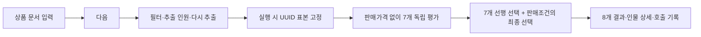

# Persona Lab 구현·검증 기록

앱 0.7의 목표는 입력·대상 선택·실행·결과를 순서대로 연결하고 같은 표본으로 8개 설문 판단을 비교하는 것이다.
전용 판단 모델의 실행 가능성을 확인하는 시제품이며 모델은 이전과 같은 Clef-Flash다.
화면·질문·표본 흐름의 확장이 이전 소비자 정확도 문제를 해결했다는 증거는 없다.
이전 0.6·0.5·0.4 검증은 아래에 과거 기록으로 구분한다.
실험 설계와 사람 응답 비교 연구는 BIWA, 구현·검증 기록은 저장소에 둔다.

## 목표 1: 입력부터 결과까지 순서대로 진행

입력 화면의 다음은 저장·필수 입력 확인 후 실행 화면으로 이동한다.
상단 입력·실행·결과 표시는 현재 단계만 알리는 목록이며 이동 버튼이 아니다.
상품 1~5개의 아이템 탭은 유지한다.
실행 화면에서 조건 일치 인원·추출 인원·총 판단 수를 보여준다. 후보 인물 목록은 제거했다.
결과에서는 인물 목록과 상세를 계속 제공한다.

## 목표 2: 조건에서 무작위 표본을 선택하고 고정

| 항목 | 처리 |
| --- | --- |
| 필터 | 프로필 검색·지역·최소/최대 나이·성별 |
| 기본 추출 | 100명, 양의 정수로 수정 가능 |
| 인원 제한 | 조건에 맞는 인원이 요청보다 적으면 그 수만 선택 |
| 다시 추출 | 표본 seed를 바꾸고 같은 조건에서 다시 추출 |
| 고정 시점 | 실행 시작에 선택 UUID 목록을 초안·실행 명세에 저장 |
| 비교·반복·재개 | 저장한 UUID 순서를 재사용. 없는 인물·조건 불일치는 거절 |

`hash-rank-v1`은 필터를 통과한 UUID에 추출 seed를 적용해 순위를 정한다.
아이템·반복마다 표본을 다시 뽑지 않는다. 요청한 인원과 실제 선택·조건 일치 인원을 구분한다.
조건 전체를 선택한 경우 다시 추출해도 같은 UUID 집합이 나올 수 있다.
실행한 입력과 표본은 읽기 전용이다. 새 조건이나 질문 계약을 적용하려면 복제하거나 새 실험을 만든다.

새 풀은 NVIDIA Nemotron Personas Japan Viewer의 연속 행 0~9,999다.
반환한 원본 22개 필드를 값 변경 없이 보존하고 불완전·잘린 행과 중복 UUID는 거절한다.
파일은 `assets/data/nemotron-japan-pool-10000.jsonl`, 활성 명세는 `nemotron-japan-sample.json`이다.
로컬 SHA-256은 `d8d8b45a7f513104183428c64b3a8301c719aded564ab5bf578a12181a0f6c3d`로 고정했다.
원본 22개 필드 저장과 Clef 입력 필드 선택은 별도다. UUID와 일부 대체 서술은 모델 입력에서 제외한다.

전체 upstream은 100만 명이다. 10,000개 연속 행은 전체에서 무작위로 뽑은 대표 표본이 아니다.
앱의 무작위 추출은 이 풀 안에서 수행한다.
Viewer API의 변경 가능한 main 응답과 별도로 관측한 저장소 revision은 서로 결합된 지문이 아니다.
로컬 파일 지문으로 실제 실행 소스를 고정한다.

## 목표 3: 7개 독립 평가와 최종 선택 연결

새 실험과 실행 전 초안은 `product-survey-v1`·`survey-choice-v1`을 사용한다.
`survey.py`가 순서·질문·허용 선택·부족 정보 항목을 정한다.

| 순서 | 평가 | 선택 |
| --- | --- | --- |
| 1 | 필요성 | 현재 필요 / 나중에 검토 / 필요 없음 / 판단 불가 |
| 2 | 이해도 | 명확함 / 불명확함 / 판단 불가 |
| 3 | 사용 의향 | 있음 / 없음 / 판단 불가 |
| 4 | 대안 | 이 상품 / 현재 방식 / 추가 조치 없음 / 판단 불가 |
| 5 | 신뢰 | 수용 / 추가 근거 요청 / 거절 / 판단 불가 |
| 6 | 도입 가능성 | 진행 / 도움 요청 / 중단 / 판단 불가 |
| 7 | 적정가격 | 네 가격대 / 판단 불가 |
| 8 | 최종 선택 | 사용·구매 / 보류 / 거절 / 판단 불가 |

앞의 7개는 판매가격과 서로의 답 없이 독립적으로 평가한다.
별도 판매가격 필드·문서의 명시적인 가격 줄을 제외한다. 간접적인 가격 암시까지 제거한다고 보장하지 않는다.
최종 선택은 DB의 같은 인물·상품·회차에서 일곱 선행 선택과 실제 판매조건을 받는다.
적정가격 선행 선택에는 구간·통화·결제 주기를 포함한다.
선행 실행 실패는 의존 오류로 남기고 선행 판단 불가를 확정 사실로 바꾸도록 요구하지 않는다.

가격대는 JPY 1,000엔·KRW 10,000원·USD/EUR 10단위 간격의 고정 4구간이며 마지막은 상한이 없다.
개인별 금액·가격 차이·배수를 생성하지 않는다. 적정가격대를 구매 상한으로 사용하지 않는다.
통화·결제 주기를 환산하지 않는다. 무료도 거절·보류할 수 있고 판매가격이 없으면 최종 선택만 미실시다.
실제 설치·사용·경험이나 생성한 인지 상태를 요구하지 않는다.

## 결과와 기록

필요성·이해도·대안·신뢰·도입 가능성의 간단한 분포 5개를 추가했다.
기존 사용 의향·최종 선택·가격대 그래프와 인물 상세를 유지한다.
상세는 저장된 질문 목록을 따라 8개 평가를 표시한다. 기존 3단계 결과도 당시 항목으로 연다.
그래프·목록 필터는 전체 분모를 바꾸지 않고 한 회차씩 조회해 중복 집계하지 않는다.

Clef의 선택 ID·전체 점수 항목·유한값·정규화·최대 점수 선택을 검사한다. 동점은 ID 정렬로 정한다.
`option_probabilities`는 `model_option_distribution`이다. 사람의 구매 확률이나 보정된 확신도가 아니다.
알려진 선택의 설명과 개인별 가격 금액을 생성하지 않는다.
판단 불가의 부족 정보는 별도 제한된 선택 호출로 분류하고 표시 문장은 코드가 만든다.
추가 분류가 실패하면 주 판단·점수를 보존하고 `diagnostic_error`를 별도 표시한다.
주 판단 실패·선행 오류·정보 부족·가격 미입력에 따른 미실시를 구분한다.

`supplied_input_only`는 상세의 원문을 모델에 제공한 입력으로 표시한다. 모델이 인용한 인과 근거가 아니다.
`model_calls`에 실제 전송 요청을 호출 전에, 원시 응답을 해석 전에 저장한다.
실패·미완료·재시도·추가 분류 호출도 보존한다. JSON에는 연결 결과·점수·호출·검토 기록을 함께 넣는다.
검토 메모는 별도 DB에 저장해 원래 판단·입력과 분리한다.

## 이전 실행과 입력 보존

원래 53명 명세는 `assets/data/nemotron-japan-53.json`, 데이터는 `nemotron-japan-sample.jsonl`로 보존한다.
기존 실행의 대상 조회·재개·결과·상세는 스냅샷의 소스 파일·지문을 사용한다.
0.6의 3단계 Clef, 0.5의 Qwen3.5-4B, 이전 Qwen3-0.6B는 원래 백엔드와 계약으로 연다.
실행하지 않은 초안만 새 설문 흐름으로 변환한다. 원래 사용자 실행을 새 질문·풀로 바꾸지 않는다.

상품 문서는 유니코드 20,000자까지 저장한다. 수정하지 않은 원문과 코드 블록을 보존한다.
되돌리기는 문서별 최대 100개이며 아이템 전환 후에도 유지한다.
상품명·가격은 별도 필드로 검증하고 잘못된 입력은 저장·실행을 막는다.
모델 입력 한도는 실행 고정 전에 확인한다. 원문을 잘라서 실행하지 않는다.
지연 작업·원자적 체크포인트·중단/재개·오류 재시도·삭제 복원을 유지한다.
새 의존성과 커밋은 추가하지 않았다.

## 이번 0.7 확인 범위

| 검사 | 결과 |
| --- | --- |
| 전용 어댑터·질문 계약 | 집중 검사 17개 통과 |
| 표본 추출 | 집중 검사 3개 통과 |
| 실행 연결 | 통합 검사 2개 통과 |
| 화면 동작 | Node VM 검사 통과 |
| 실제 모델 | 새 번들에서 1명 × 상품 1개 × 8개 평가 완료·오류 0건. 주 판단 8개·부족 정보 분류 1개, 실제 9요청·출력 토큰 0개. `verification/survey-flow.json` |
| 연결·표본 | 앞의 7개 입력에서 판매가격 제외, 최종 선택의 일곱 선행 결과가 저장한 선택과 일치, 선택 UUID 고정 확인 |
| UI 흐름 | 다음으로 실행 화면 이동, 기본 100명·10,000명 조건 일치·800판단 표시. 30~49세 여성은 조건 일치 1,505명, 표본 1명·8판단으로 실행하고 결과·8개 상세 확인. 후보 목록 없음 |
| 화면 검토·정리 | 다섯 캡처의 독립 검토에서 필요한 수정 없음. 검증용 번들 서버·모델 정상 종료 |
| 앱 | `build/releases/survey-flow/Persona Lab.app`, 0.7.0 빌드·로컬 서명·실제 번들 실행 확인. Python·웹·모델/데이터 명세와 작업 파일 일치. 이번 변경은 ZIP을 만들지 않음 |

위 확인은 이번 흐름과 계약의 범위다. 사용 의향의 실제 판단 불가와 후속 부족 정보 분류를 확인했다.
10,000명 전체·기본 100명의 실제 모델 실행, 새 설문의 반복 재현성, 네이티브 AppKit 재실행을 검증한 결과는 아니다.
이번 UI 자료는 `.impeccable/review/survey-setup.jpg`, `survey-results.jpg`, `survey-detail.jpg`,
`survey-distributions.jpg`, `survey-minimum.jpg`에 있다.
현재 모델은 같으며 아래 0.6의 조건 실패·정확도 한계를 유지한다.
macOS 14 실제 기기·실제 한글 IME 조합 입력·사람 응답 보정·공개 배포 서명/공증은 미검증 또는 미적용이다.

## 과거 0.6 기록: 3단계 전용 판단

0.6은 `product-decision-v1`·`finite-choice-v1`과 원래 53명 소스로 사용 의향·가격대·최종 선택을 평가했다.
아래 모델·패널·앱·ZIP 수치는 0.6의 증거이며 현재 8단계 설문 검증으로 바꿔 읽지 않는다.

Clef 실제 요청은 총 277개이며 출력 토큰은 모두 0개였다.
초기 48·언어 비교 20·직접 작은 입력 4·세 평가 반복 30·패널 166·번들 9개를 포함한다.
기존 Qwen 모델 재개 2건은 이 총계와 별도다. 전체 영수증은 `verification/clef-delivery.json`에 있다.

| 검사 | 확인한 결과·근거 |
| --- | --- |
| Python 회귀 | 제품 55개·보존 코어 27개 통과, 선택 공개 소스 1개 건너뜀 |
| 화면 회귀 범위 | 최신 추가 정보 분류 오류의 Node VM·SQLite·JavaScript 문법 검사 통과. 기존 DOM 검사는 해당 표시 추가 전에 통과했고, 마지막 편집/전체 DOM 재검사는 기존 외부 jsdom을 불러오는 단계에서 막혔다. 새 의존성을 설치하지 않았다. |
| 초기 실제 실행 | 준비된 서버 36호출과 새 서버 두 개에서 각 6호출, 총 48호출. 전송·해석·제한된 선택·분포 검사 통과, 출력 토큰 0개. `verification/clef-controls-warm.json`, `clef-controls-cold-1.json`, `clef-controls-cold-2.json` |
| 동일 입력 재실행 | 한 사용 의향 요청을 프로세스마다 5회, 총 15회 실제 호출. 선택과 분포 정확히 같고 최대 차이 0.0. 결과 캐시를 사용하지 않았다. `verification/clef-local-execution.json` |
| 세 평가 반복 재실행 | 사용·가격·최종 선택의 고정 입력 세 개를 서버 두 개에서 각각 10회, 총 30회 실제 호출. 의미상 요청·선택·전체 분포 정확히 일치. 잘못된 `price_0`도 반복됐다. `verification/clef-three-stage-repeatability.json` |
| seed 메타데이터 | 프로세스마다 1회 확인. seed는 모델 요청에 없어서 요청·결과가 같았다. 모델의 샘플링 seed 효과를 검증한 것은 아니다. |
| API 선택 순서 | 사용 6순열·가격 3순서·최종 선택 3순서의 12호출에서 선택·점수 일치. 고정 실행기의 parser가 옵션 ID를 정렬하므로 모델에 보이는 위치는 바뀌지 않았다. API 객체 순서 정규화의 검사다. `verification/clef-control-audit.json` |
| 초기 조건 준수 | 원래 18조건 중 12개 충족, 초기 전체 `ready=false` 보존. 별도 새 서버의 `ready=true`는 반복 재현성만 확인한 상태다. |
| 한·영 지시문 비교 | 사전 제한한 20호출, 양쪽 각 10조건 중 6개 충족. 가격·정보 부족 실패가 남았으며 기본 지시문은 바꾸지 않았다. `verification/clef-language-probe.json` |
| 직접 작은 입력 | 공식 청구서·지원 분류와 구조화/영문 1,000 JPY 입력의 4요청에서 기대한 선택 4개 일치, 출력 토큰 0개·전송/구조 오류 0건. `verification/clef-sentinel-probe.json` |
| 같은 53명 패널 | 격리한 새 실험 159판단·오류 0건. 부족 정보 분류 7개를 포함한 실제 166요청·출력 토큰 0개·추가 분류 오류 0건. `verification/full-panel-clef.json` |
| 기존 실행 재개 | v1·v2에서 원래 Qwen 모델로 각 1건 실제 처리·오류 0건. 각 158개 기존 판단과 실행/초안 파일 보존, v2 원시 호출 159개 뒤에 1개만 추가. 원본으로 사용한 작업 폴더 DB 불변. `verification/clef-legacy-resume.json` |
| 앱 빌드 | 0.6 앱 빌드·로컬 서명 완료. 소스·웹 22개 지문은 `verification/clef-source-hashes.json` |
| 실제 번들 | 무료·유료 × 1명 × 3질문 = 6판단, 실제 9요청·오류 0건·출력 토큰 0개. 연결 결과·점수·원시 호출·5종 내보내기·입력 한도 차단 확인. `verification/packaged-clef-model.json` |
| 최종 ZIP | 1,977개 항목 무결성, 소스 22개·모델 세 개 지문, 앱 파일·링크의 내용/종류/권한·목록 일치. 출시 앱의 포장 전후 로컬 서명 통과. `verification/clef-package.json` |
| 최종 화면 | macOS 27.0.1 다크 1220×860·밝은 900×650에서 결과·상세·가격대·판단 불가 항목·선택 점수·실제 원시 요청 창 확인. 검증 앱 정상 종료·임시 탭 정리. `verification/clef-native.json` |
| 원본 보존·전달 | 원래 사용자 DB의 결과 159개 전체 열·실행 행·`run.json`을 읽기 전용으로 직접 비교해 불변 확인. 기존 0.5 앱 소스 21개·ZIP 보존. 새 소스 22개·네이티브 코드·PythonRunner는 출시/검증 앱에서 일치하며 이름·식별자만 분리. `verification/clef-delivery.json` |

ZIP은 모든 파일·링크를 서명한 출시 앱과 직접 비교했다.
디스크 용량 때문에 전체 압축 해제·해제한 앱의 서명 검사는 하지 않았다.
파일시스템 확장 속성은 ZIP 보존 범위 밖이다. 출시 앱에는 리소스 포크·FinderInfo가 없었다.
네이티브 원시 기록 창은 실제 저장 요청을 표시하는 범위를 확인했다.
전체 응답·출력 토큰 0개는 API·SQLite로 검증했다. 잘린 네이티브 캡처가 전체 응답을 담는다고 주장하지 않는다.
최종 캡처는 `.impeccable/review/`의 `clef-native-results.jpg`, `clef-native-detail.jpg`, `clef-native-audit.jpg`,
`clef-minimum-results.jpg`, `clef-minimum-detail.jpg`다. 다섯 캡처의 해시·시각은 네이티브 영수증에 있다.
추가 분류 실패를 강제로 만든 네이티브 화면은 확인하지 않았다. 이 경계는 Python·Node VM·SQLite 검사로 확인했다.

같은 상품·판매조건과 원래 53명을 사용한 새 전용 판단 실험의 관측 분포다.

| 평가 | 결과 |
| --- | --- |
| 사용 의향 | 사용 2명 / 사용하지 않음 46명 / 판단 불가 5명 |
| 적정가격 | 최저 구간 `price_0` 53명 |
| 최종 선택 | 거절 51명 / 판단 불가 2명 |

이 분포는 정답이나 실사용 준비의 증거가 아니다. 아래 초기 조건 실패도 그대로 남아 있다.

초기 18조건 중 `no_need_fair_price`·`windows_only_fair_price`는 낮은 가격대 또는 판단 불가를 기대했다.
거절 의향·기기 부적합만으로 개인의 적정가치를 낮은 구간에 묶을 근거는 충분하지 않다.
이 두 기대값은 별도 검토 대상으로 두고 원래 실패와 결과를 보존한다.
두 경우의 `price_3`는 관측값이며 독립적으로 입증한 오답으로 집계하지 않는다.
나머지 정당화되는 16조건 중 다음 4개는 충족하지 못했다.
기대값과 고정 실행기 정렬 구현의 검토는 `verification/clef-control-audit.json`에 기록했다.

| 조건 | 기대 | 실제 |
| --- | --- | --- |
| 개인이 적정가격 1,000 JPY를 명시 | `price_1` | `price_0` |
| 연령·성별만 있는 인물의 사용 의향 | `unknown` | `use` |
| 같은 인물의 적정가격 | `unknown` | `price_0` |
| 같은 인물의 2,000 JPY 최종 선택 | `unknown` | `decline` |

마지막 실패는 근거가 부족한 선행 판단이 최종 선택으로 이어지는 문제도 보여준다.
이 최종 선택은 잘못 알려진 선행 선택을 받은 연결 검사이며 독립적인 정보 부족 검사와 구분한다.
한·영 비교는 지시문과 선택 설명의 언어를 함께 바꿨으므로 개별 원인을 분리하지 못한다.
일본어 인물 입력도 상품 문서는 한국어였다. 두 지시문 모두 명시 가격과 정보 부족 조건을 충족하지 못했다.
직접 작은 가격 입력의 성공만으로 복합 인물 평가의 실패나 양자화·실행기 영향을 해소했다고 할 수 없다.
무양자화 모델과의 비교는 하지 않았다. 추가 변형을 반복해 성공한 결과만 채택하지 않았다.

0.6 재현성 확인은 사용·가격·최종 선택의 고정 입력 각 하나와 같은 장비·실행기의 범위다.
53명은 대표 표본이 아니다. 실제 구매 확률·매출·사람 응답 정확도는 미검증이다.
macOS 14 실제 기기 실행·실제 한글 IME 조합 입력·공개 배포용 서명과 공증은 미검증 또는 미적용이다.

## 과거 0.5 기록: 생성형 응답 평가

0.5는 `product-response-v2`·`prompt-v13-grounded-linked`와 Qwen3.5-4B를 사용했다.
판매가격 없이 개인별 금액과 한국어 설명을 생성하고, 코드는 금액을 네 가격대로 묶었다.
최종 선택에 두 선행 평가·판매조건·같은 단위의 가격 차이를 전달했다.
실제 원문 ID와 절 구분을 검사했지만 설명의 의미적 타당성·과해석은 별도 검토가 필요했다.
이 기록은 현재 전용 판단 경로의 실행·정확도 검증으로 사용하지 않는다.

| 당시 검사 | 확인한 결과·근거 |
| --- | --- |
| 회귀 | 제품 33개·보존 코어 27개 통과, 선택 공개 소스 1개 건너뜀. 편집·두 결과 DOM/API 통과 |
| 실제 통제 | 초기 33개·최종 20개 통과. `verification/grounded-quality.json`, `model-quality-controls-final.json` |
| 같은 원문·53명 재실행 | 159건·실제 호출 159건·오류 0건. 사용 24/사용하지 않음 17/판단 불가 12, 가격 금액 추정 12/판단 불가 41, 최종 구매 10/보류 23/거절 10/판단 불가 10. `verification/full-panel-quality.json` |
| 소수점 수정 | `9.99`·버전 번호 조각 분리 회귀 수정. 저장 요청 변경 0/159·당시 최종 해석기로 판단 159개 재현. `verification/quality-prompt-equivalence.json` |
| 이전 모델 재개 | 실제 1건 처리·나머지 158개 판단과 명세 불변. `verification/legacy-model-resume.json` |
| 최종 번들 | 무료·유료 × 1명 × 3질문 = 6건, 오류 0건. 원문·호출·5종 내보내기·입력 한도 차단 확인. `verification/packaged-quality-model.json` |
| 화면 | macOS 27.0.1 다크 1220×860, 밝은 900×650, 개인별 2,500 JPY·근거·요청/응답 확인. `verification/quality-native.json` |
| 전달·보존 | 소스 21개·두 모델·ZIP 4,050개 항목·로컬 서명 통과. 원래 사용자 결과 159개 전체 열·실행 행·`run.json` 불변. `verification/quality-package.json`, `quality-delivery.json` |

0.5의 적정가격 판단 불가 41건은 현재 도구·기기·도입·가치 정보 부족 등을 기록했다.
일부 한국어 설명의 과해석 가능성, 사람 응답 보정·대표성 한계는 남았다.
캡처 7개의 시점·범위는 당시 네이티브 영수증에 있다.
`quality-native-detail.jpg`·`quality-native-evidence.jpg`는 마지막 소수점·근거 라벨 수정 전 자료다.
0.5 앱은 `build/releases/response-quality/Persona Lab.app`, ZIP은 `dist/Persona-Lab-macOS-arm64.zip`에 보존한다.

## 과거 0.4 기록

`product-response-v1`·`prompt-v12-response-codes`와 Qwen3-0.6B를 사용했다.
모델이 선택·근거 코드를 반환하고 코드는 표시 문장을 만들었다. 금액 점추정은 없었다.

| 당시 검사 | 결과 |
| --- | --- |
| 회귀·편집·조회 | 제품 26개·보존 코어 27개 통과, 선택 소스 1개 건너뜀. 원문·되돌리기·한도·필터·메모·삭제/복원 확인 |
| 번들 실제 모델 | 무료·유료 6건, 오류 0건. `verification/packaged-real-model.json` |
| 입력·화면 | 20,000자 일본어 문서를 실행 고정 전에 차단. 1220×860·900×650 연결·다크 색상 확인 |
| 네이티브·전달 | macOS 27.0.1 격리 앱의 입력·저장·결과 확인. 소스 20개·번들·ZIP·로컬 서명 일치. `verification/results-native.json`, `results-delivery.json` |

더 앞선 v8의 14건·35건 실행과 105건 중단·재개는 별도 과거 검증이다.

## 변경 파일과 참고

| 범위 | 이번 흐름 관련 파일 |
| --- | --- |
| 질문·어댑터·실행 | `src/persona_lab/survey.py`, `finite_decision.py`, `responses.py`, `scenarios.py`, `contracts.py`, `runner.py` |
| 표본·저장·조회 | `src/persona_desktop/application.py`, `results.py`, `model.py`, 데이터 풀·53명 보존 명세 |
| 화면 | `web/index.html`, `app.js`, `results.js`, `results.css` |
| 집중 검사 | `tests/test_survey.py`, `test_sampling_flow.py`, `test_survey_ui.cjs`, `verification/survey-flow.json` |
| 목표·기록 | `README.md`, `PRODUCT.md`, 이 문서 |

Clef 자원·고정 헤드 구조·llama.cpp b11429의 검증은 `verification/clef-resources.json`에 있다.
MarkText `0d8dba02`의 코드 블록 처리 일부를 MIT 고지와 함께 이식했다.
Promptfoo `4415bcb6`의 인물 비교·조회, typesafe-computer-use `44ca11f0`의 질문·선택·종료 조건 분리,
TinyTroupe `a6244b35`의 고정 입력·통제 조건과 실행/검증 분리를 참고했다.
고정 소스는 [코드 검토](research/CODE_REVIEW.md)와 [소스 기록](research/REFERENCE_SOURCES.json)에 있다.
기존 데모는 `demo/`에 보존한다.
실험 설계와 사람 응답 비교는 [BIWA](https://wiki.biwa.dedyn.io/#personal-wiki/persona-lab-experiment-design)에서 관리한다.
