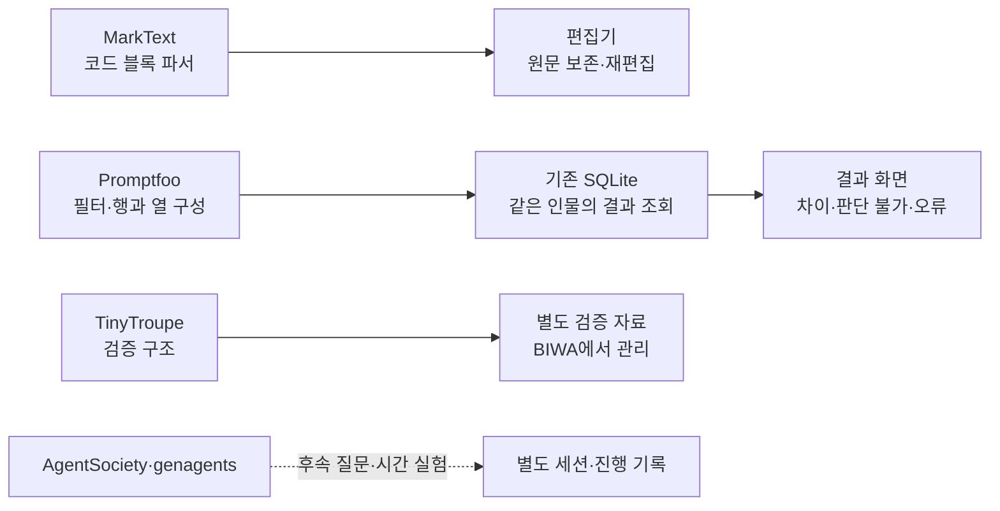

# Persona Lab 외부 코드 적용 검토

MarkText의 작은 파서 함수와 Promptfoo의 결과 조회 방식을 먼저 적용하는 것이 적합하다. TinyTroupe는 검증 개념을 참고하되 범주 변환·무작위 처리·품질 점수를 그대로 사용하지 않는다. AgentSociety와 genagents의 상태 유지 엔진은 후속 질문과 시간에 따른 실험이 필요할 때 검토한다.

2026-10-06 검토. 소스는 로컬 `.research/upstream`에 보관했다. 복제 소스는 Git에 포함하지 않는다. 커밋·자료 해시·확인 파일은 [소스 기록](REFERENCE_SOURCES.json), 실행 관측은 [검토 결과](REFERENCE_PROBES.json)에 있다. 큰 저장소는 필요한 모듈과 관련 검사를 선별했다. 이 문서의 관측은 통합 전 검토 기록이다. 현재 적용 상태는 [구현 기록](../../IMPLEMENTATION.md)에 있다. 상위 프로젝트 전체 실행은 수행하지 않았다.

이 검토의 부분 이식안은 현재 단발 평가의 유지 비용을 기준으로 했다. 인물 상태·기억·후속 질문을 제품의 코어로 확장하는 경우에는 [TinyTroupe 기반 구조 제안](TINYTROUPE_ARCHITECTURE.md)을 검토한다. 아래의 파서·조회 개선과 검증 문제는 그 기반안에서도 적용된다.

## 적용 경계

## 코드 확보와 적용 판정

| 대상 | 확보한 자료 | 적용 판정 |
| --- | --- | --- |
| MarkText | 커밋 `0d8dba02`, Muya 0.2.0의 소스·검사·MIT LICENSE | 작은 함수와 회귀 사례를 부분 이식한다. 편집기 전체 교체는 별도 선택이다. |
| Promptfoo | 커밋 `4415bcb6`, 비교 화면·SQLite 조회·관련 검사 152파일 | 행 구성·필터·페이지 조회를 현재 Python·JavaScript로 이식한다. React 화면 전체는 가져오지 않는다. |
| TinyTroupe | 커밋 `a6244b35`, 0.7.0 소스·MIT LICENSE | 실제 응답 비교 구조를 참고한다. 재현한 변환 문제를 피해서 검증을 작성한다. |
| AgentSociety | 커밋 `8cc5bb9a`, 2.9.3 저장·재생·추적·관련 검사 62파일 | 기록 스키마만 참고한다. 현재 SQLite 저장·복구를 대체하지 않는다. |
| Stanford genagents | 커밋 `96854071`, 응답·기억·저장 코드와 MIT LICENSE | 후속 질문의 계약 후보로 둔다. 현재 독립 비교에 기억을 넣지 않는다. |
| Obsidian | 커밋 `9abd9605`, 공식 API 타입 정의·MIT LICENSE | 편집기 본체를 가져온 것이 아니다. API 계약과 동작 참고에 한정한다. |
| Synthetic Users | Python SDK 1.0.0 소스 배포판, SHA-256 확인 | HTTP 클라이언트와 데이터 관계만 확인했다. 시뮬레이션 엔진이 아니다. 메타데이터는 Proprietary다. |
| Aaru | 공식 제품 문서 | 공식 경로에서 받을 수 있는 시뮬레이션 엔진 소스를 찾지 못했다. 화면 흐름 참고에 한정한다. |

LM Studio는 사용자 요청에 따라 제외했다. 검색에 등장한 `aaru-dps`는 디스크 이미징 프로젝트이므로 Aaru 소비자 시뮬레이터의 코드로 취급하지 않는다. Synthetic Users 문서에 있는 TypeScript SDK 저장소는 GitHub에서 404를 반환했다. 위 Python SDK 확보와 구분한다.

## MarkText에서 옮길 부분 — 통합 전 관측

[Muya의 파서 함수](https://github.com/marktext/marktext/blob/0d8dba02bb77efdf33198a3b197bf8fdb42bec79/packages/muya/src/utils/index.ts#L59) 중 `parseFenceLine`과 `firstWordOfInfo`는 주변 편집기 상태를 요구하지 않는다. 긴 백틱, 물결표와 코드 블록의 추가 정보를 다룬다. `parseFenceLine`을 분리해 Node의 기본 TypeScript 처리로 실행했다. 패키지를 설치하지 않았다.

| 문서 사례 | MarkText의 시작 줄 인식 | 검토 당시 앱의 코드 표시 | 다른 제목 수정 후 블록 원문 |
| --- | --- | --- | --- |
| 물결표로 감싼 코드 | 인식 | 실패 | 변경됨 |
| 백틱 4개 안에 백틱 3개가 있는 코드 | 인식 | 실패 | 변경됨 |
| 언어 뒤에 추가 정보가 있는 코드 | 인식 | 실패 | 변경됨 |

검토 당시 `web/editor.js`의 `toHTML`과 `toMarkdown`은 백틱 3개와 단순 언어 이름만 다룬다. 위 세 사례는 화면 표시만의 문제가 아니다. 제목 하나를 수정한 뒤 저장할 문서에서도 코드 블록이 달라졌다. 원문 보존을 먼저 고쳐야 한다.

최소 적용은 다음과 같다.

1. 시작 줄의 표시 문자, 표시 길이와 전체 추가 정보를 보관한다.
2. 같은 문자이며 길이가 충분한 닫는 줄만 인정한다.
3. 코드 본문에 서식 변환을 적용하지 않는다.
4. 저장할 때 보관한 표시와 추가 정보를 사용한다.
5. 세 사례, 빈 줄, 한국어·이모지와 되돌리기를 회귀 검사에 넣는다.

함수만 복사해서는 닫는 줄과 저장 문제까지 해결되지 않는다. `web/editor.js`의 파싱 상태와 직렬화도 함께 바꿔야 한다. 이식한 코드에는 MarkText의 저작권·MIT 고지를 보존한다.

Muya 전체 교체는 더 큰 작업이다. [package.json](https://github.com/marktext/marktext/blob/0d8dba02bb77efdf33198a3b197bf8fdb42bec79/packages/muya/package.json)에 렌더러, 정제기, 문서 파서, RxJS와 연산 이력을 위한 패키지가 있다. 수학·그림·차트 기능도 의존성에 포함한다. 단일 화면 부품을 복사하면 이 연결도 따라온다.

[markdownToState](https://github.com/marktext/marktext/blob/0d8dba02bb77efdf33198a3b197bf8fdb42bec79/packages/muya/src/state/markdownToState.ts)와 [stateToMarkdown](https://github.com/marktext/marktext/blob/0d8dba02bb77efdf33198a3b197bf8fdb42bec79/packages/muya/src/state/stateToMarkdown.ts)는 블록 상태를 사이에 둔다. 문서 전체 바이트를 보존하는 편집기로 간주하면 안 된다. 지원 문법과 정규화 규칙을 먼저 정해야 한다.

전체 교체를 선택할 때는 기존 편집기의 계약을 어댑터로 유지한다.

| 현재 앱의 계약 | Muya 쪽 연결 | 확인할 경계 |
| --- | --- | --- |
| 문서 열기·저장 | `setContent`, `getMarkdown`, `flush` | 아이템 전환 전에 대기 중인 편집을 반영한다. |
| 자동 저장 알림 | 이벤트 구독 | 조합 입력과 프로그램의 문서 교체를 구분한다. |
| 되돌리기·다시 실행 | Muya의 연산 이력 | macOS 메뉴와 같은 이력을 사용한다. |
| 실행한 문서 잠금 | 컨테이너와 이벤트 차단 어댑터 | 현재 소스는 내부 컨테이너를 편집 가능으로 만든다. 부모 속성만 바꾸면 부족하다. |
| 가져온 원문 보존 | 원문과 편집 구간 관리 | 지원하지 않는 문법을 다른 부분 수정 때문에 바꾸지 않는다. |

현재 `renderItems`가 편집기 요소의 `contentEditable`을 직접 바꾸므로, 전체 교체에는 그 호출도 편집기 어댑터로 옮겨야 한다. 지금은 작은 파서 이식이 더 작고 검증 가능한 변경이다.

## Promptfoo에서 옮길 부분

[convertResultsToTable](https://github.com/promptfoo/promptfoo/blob/4415bcb630155ffe40b31ec3feb038240ce33938/src/util/convertEvalResultsToTable.ts)는 같은 검사 입력을 행으로, 프롬프트·모델을 열로 묶는다. 우리 앱에서는 행을 같은 인물·질문·반복, 열을 아이템으로 바꾸면 된다.

[buildFilterWhereSql와 queryTestIndices](https://github.com/promptfoo/promptfoo/blob/4415bcb630155ffe40b31ec3feb038240ce33938/src/models/eval.ts#L937)는 필터 조건과 페이지 조회를 나눈다. [FilterModeProvider](https://github.com/promptfoo/promptfoo/blob/4415bcb630155ffe40b31ec3feb038240ce33938/src/app/src/pages/eval/components/FilterModeProvider.tsx)와 [ResultsTable](https://github.com/promptfoo/promptfoo/blob/4415bcb630155ffe40b31ec3feb038240ce33938/src/app/src/pages/eval/components/ResultsTable.tsx)는 React·Zustand·테이블 라이브러리와 연결된다. 현재 화면에 그대로 붙일 부품은 아니다.

검토 당시 `src/persona_lab/runner.py`의 `results` 테이블에 이미 필요한 연결 키가 있다. 저장 형식을 바꾸거나 새 데이터베이스를 넣지 않아도 된다.

| 조회 모드 | 판정 기준 | 표시할 것 |
| --- | --- | --- |
| 전체 | 같은 인물·질문·반복으로 연결 | 아이템별 선택과 상태 |
| 달라진 판단 | 유효한 두 선택 코드가 다름 | 구매→거절 등의 변화 |
| 판단 불가 | 어느 아이템의 선택이 `unknown` | 판단 불가 사유와 조건 |
| 오류 | 어느 아이템의 상태가 `backend_error` | 오류와 당시 입력 |

응답 문자열 전체를 비교하면 사유 표현만 달라도 변화로 보인다. 우리 앱은 선택 코드의 변화를 기본으로 하고 사유는 상세에서 확인하는 것이 적합하다. Promptfoo의 pass/fail 색상도 구매 선택의 좋고 나쁨으로 옮기지 않는다.

299개 결과 행을 기존 스키마에 넣은 분리 검사에서 다음을 확인했다.

- 반복 2회가 다른 반복과 섞이지 않고 연결된다.
- 최초 28건 뒤에 있는 오류를 필터로 찾는다.
- 판단 불가와 오류를 구분한다.
- 한쪽 결과가 없는 비교를 완료 쌍으로 세지 않는다.
- 페이지가 겹치지 않으며 전체 결과 행 수는 유지된다.

이 검사는 제안한 SQLite 조회를 확인했다. Promptfoo 서버를 실행하거나 새 화면을 검증한 결과는 아니다.

구현할 경계는 `reports.py`의 페이지 조회, `application.py`의 조회 메서드, `server.py`의 조회 경로, `app.js`의 필터와 비교 상세다. 입력 값은 SQL 매개변수로 전달한다. 모드와 아이템 ID는 허용 목록으로 검사한다.

필터가 바뀌면 첫 페이지로 돌아간다. 늦은 응답은 실험 ID와 조회 번호로 거른다. 상세는 화면의 행 번호 대신 기존 `job_id`를 사용한다. 읽기 트랜잭션에서 목록과 개수를 함께 조회한다.

상단 전체 집계의 분모는 유지한다. 필터를 적용한 사례 수는 별도로 표시한다. Promptfoo의 필터 집계를 그대로 적용하면 결과 의미가 바뀌므로 이 경계는 우리 앱 기준으로 작성한다.

## TinyTroupe에서 그대로 가져오면 안 되는 부분

[SimulationExperimentEmpiricalValidator](https://github.com/microsoft/TinyTroupe/blob/a6244b358a1fe1c71bf751f7ba0f8dfa368ec5a4/tinytroupe/validation/simulation_validator.py#L741)는 실제 자료와 합성 자료를 비교하는 구조다. 그러나 현재 구현의 전처리는 우리 선택 코드에 맞지 않는다.

분리한 순수 메서드에서 `buy`만 있는 자료와 `decline`만 있는 자료를 변환했다. 각각의 자료가 독립적으로 범주 번호를 만들기 때문에 둘 다 `[0,0,0,0]`이 됐다. 같은 숫자로 바뀌어도 의미는 정반대다. 공통 선택 코드 집합의 비율을 비교하면 두 분포의 차이는 최대값이다.

[ABRandomizer.randomize](https://github.com/microsoft/TinyTroupe/blob/a6244b358a1fe1c71bf751f7ba0f8dfa368ec5a4/tinytroupe/experimentation/randomization.py#L39)는 호출마다 같은 seed로 난수 생성기를 만든다. seed 42로 32번 호출하면 제시 순서가 모두 같았다. 이 코드를 항목별 순서 효과 검사로 가져오면 균형 잡힌 배치를 만들지 못한다.

추가로 사유의 의미 비교는 두 자료의 사유를 모든 조합으로 비교한다. LLM 평가 경로도 포함한다. 최종 점수에는 통계 효과 크기의 변환과 의미 점수가 섞인다. 이를 구매 예측 정확도로 표시하지 않는다.

우리 검증에서는 공통 선택 코드별 빈도를 보존한다. 범주를 임의의 서열 숫자로 바꾸지 않는다. 선택지 순서 검사에는 저장한 순서표를 사용한다. 조건 위반은 원래 판단을 보존한 채 별도로 기록한다. 실제 사람 자료와 비교하는 실험은 [BIWA 실험 설계](https://wiki.biwa.dedyn.io/#personal-wiki/persona-lab-experiment-design)에서 관리한다.

TinyTroupe 전체는 Pandas, SciPy, OpenAI 클라이언트와 문서·노트북 패키지까지 요구한다. 현재 설치형 앱의 기본 실행기에 넣는 것보다 별도 검증 작업으로 두는 것이 적합하다.

## AgentSociety와 genagents의 적용 범위

[ReplayDatasetSpec](https://github.com/tsinghua-fib-lab/AgentSociety/blob/8cc5bb9a9c27d039ec5519375db9d73ccf508cba/packages/agentsociety2/agentsociety2/storage/replay_metadata.py)은 스냅샷·사건·지표 기록을 구분한다. [ReplaySink](https://github.com/tsinghua-fib-lab/AgentSociety/blob/8cc5bb9a9c27d039ec5519375db9d73ccf508cba/packages/agentsociety2/agentsociety2/storage/replay_sink.py)은 분산 JSONL 기록을, ReplayReader는 DuckDB 조회를 사용한다. 이는 현재 단일 앱의 결과와 체크포인트를 같은 SQLite 트랜잭션으로 저장하는 방식과 다르다.

필요하다면 작업 ID, 시도 번호, 시작 시각, 처리 시간과 오류를 기록하는 작은 스키마를 참고할 수 있다. Ray·DuckDB·분산 기록은 인물 간 상호작용과 여러 작업 프로세스가 실제로 필요할 때 검토한다. 원자적 파일 쓰기도 현재 `atomic_json`이 제공하므로 중복 도입하지 않는다.

[genagents interaction](https://github.com/StanfordHCI/genagents/blob/96854071ef4c2d79c93144c973c7820722d52bab/genagents/modules/interaction.py)은 질문에서 검색한 기억과 인물 설명을 합쳐 응답을 만든다. [MemoryStream](https://github.com/StanfordHCI/genagents/blob/96854071ef4c2d79c93144c973c7820722d52bab/genagents/modules/memory_stream.py)은 관련성·최근성·중요도를 조합한다. NumPy와 OpenAI 호출 경로가 연결되어 있다.

현재 독립 아이템 비교에 기억을 공유하면 먼저 본 상품의 응답이 다음 상품에 영향을 준다. 후속 질문은 별도 세션에서 당시 원문·조건·원래 판단을 고정하고, 추가 질문과 응답을 원래 `job_id`에 연결하는 방식이 적합하다. 기존 판단과 새 요약·대화를 덮어쓰지 않는다.

## 공개 본체를 확보하지 못한 제품

Obsidian의 [공식 저장소](https://github.com/obsidianmd/obsidian-api/blob/9abd9605ce081383674aae1ed111c456edde0688/README.md)는 API 타입 정의다. `getValue`, `replaceRange`, `transaction` 같은 계약은 볼 수 있지만 Live Preview 구현은 이 자료에 없다. 이를 편집기 엔진으로 이식하는 계획은 세울 수 없다.

Synthetic Users의 Python 배포판은 OpenAPI로 생성한 HTTP 클라이언트다. `StudyCreate`는 대상·문제·자료·인터뷰를 연결하고 `studies_api.py`는 서버 요청을 보낸다. 이 코드를 받아도 인물 생성과 인터뷰 엔진이 로컬에서 실행되는 것은 아니다. 배포 메타데이터의 Proprietary 표기 때문에 재사용 허용을 전제하지 않는다. 관계 설계만 참고한다. [배포 정보](https://pypi.org/project/syntheticusers/)

Aaru는 [공식 제품 흐름](https://aaru.com/simulation)을 참고한다. 검색으로 찾은 동명 저장소를 연결하지 않는다. 두 제품에 대해서는 엔진 내부 구조·출력 정확도·로컬 실행 가능성을 코드로 확인했다고 말하지 않는다.

## 검토 당시 구현 순서

| 순서 | 변경 | 필요한 검사 |
| --- | --- | --- |
| 1 | MarkText 파서 함수의 부분 이식과 코드 블록 상태·저장 보강 | 위 3개 원문 변형 사례, 긴 표시 안의 짧은 표시, 빈 줄, 한국어 입력·되돌리기 |
| 2 | Promptfoo 방식의 결과 페이지·필터·아이템별 비교 상세 | 뒤쪽 오류, 반복 연결, 불완전 비교, 조회 개수 일치, 늦은 응답, 전체 분모 보존 |
| 3 | 상품 문서 차이와 검토 메모 | 고정한 입력 기준의 비교, 원래 판단 보존 |
| 후속 | 후속 질문과 진행 기록 | 아이템 간 기억 격리, 버전·질문 순서·부모 작업 추적 |

새 패키지 없이 수행할 첫 변경은 1과 2다. Muya 전체·외부 SDK·사회 시뮬레이션 엔진 도입은 이 두 변경과 분리한다.

아래 검사는 현재 편집기의 관측을 출력한다. 최초 관측은 `REFERENCE_PROBES.json`에 보존한다.

분리 검사 실행: `python3 tools/probe_reference_adapters.py`. 이미 설치한 개발용 jsdom 경로는 `PERSONA_LAB_JSDOM`으로 지정한다. 검사는 고정한 소스 스냅샷이 있는 로컬 작업공간에서 실행한다. 실행 전 소스 기록의 SHA-256으로 확인할 수 있다.
