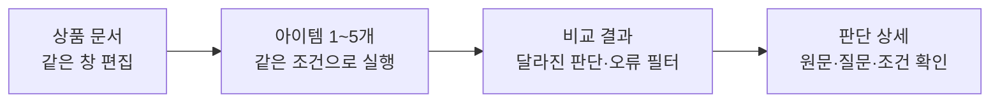

# Persona Lab 제품 참고 프로젝트

코드 검토에서 문서 원문 보존을 먼저 고쳐야 할 사례를 확인했다. 그다음 결과 필터와 비교 상세를 보강한다. 같은 창 편집, 아이템 1~5개, 기본 데이터·모델 탑재를 유지한다.

2026-10-06 공식 저장소와 문서 기준이다. 아래 적용안은 후속 개발 제안이다.

실제 소스의 확보 범위, 이식할 함수와 분리 실행 결과는 [코드 적용 검토](CODE_REVIEW.md)에 정리했다. LM Studio는 검토 대상에서 제외했다.

## 프로젝트별 참고점

| 프로젝트 | 공식 문서에서 확인한 기능 | Persona Lab 적용안 |
| --- | --- | --- |
| [Obsidian](https://obsidian.md/help/edit-and-read) | 같은 편집 영역에서 서식을 표시한다. 커서가 들어간 서식의 Markdown 문법을 다시 보여준다. | 제목 단계와 링크 주소를 같은 창에서 다시 고친다. 별도 미리보기 탭은 추가하지 않는다. |
| [MarkText](https://raw.githubusercontent.com/marktext/marktext/develop/docs/EDITING.md) | 실시간 서식, 선택한 글의 서식 메뉴, 링크·표 편집을 제공한다. 파일 인코딩과 줄바꿈 형식도 다룬다. | 표와 링크를 직접 고칠 수 있게 한다. 가져온 문서는 지원하지 않는 문법과 공백도 보존하도록 편집 검사를 보강한다. |
| [Promptfoo](https://www.promptfoo.dev/docs/usage/web-ui/) | 결과에서 오류·차이·검토 표시를 필터링한다. 개별 셀에서 입력·출력·평가를 확인한다. 이전 실행과 비교하고 설정을 내보낸다. | 달라진 판단·판단 불가·오류 필터를 둔다. 5개 아이템 중 기준 아이템을 고르면 해당 비교를 먼저 보여준다. |
| [Synthetic Users](https://docs.syntheticusers.com/guides/first-study) | 대상 패널과 연구를 연결하고, 전체 또는 개별 인터뷰에 후속 질문을 한다. [보고서 문서](https://docs.syntheticusers.com/guides/generating-reports)는 원본 인터뷰·요약·보고서를 구분한다. | 집계에서 해당 인물의 판단 상세로 이동한다. 향후 후속 질문은 원래 판단과 별도 기록으로 저장한다. |
| [Aaru](https://aaru.com/simulation) | 목표·대상·질문을 연결한다. 단일 선택, 복수 선택, 순위와 자유 응답을 설명한다. 결과를 질문에 연결하는 흐름을 제시한다. | 실험 이름을 확인할 질문으로 쓸 수 있다. 예: “가격을 낮추면 어떤 판단이 달라질까?” 새 입력 단계는 요구하지 않는다. |
| [TinyTroupe](https://github.com/microsoft/TinyTroupe) | 상품 피드백·포커스 그룹 예제가 있다. 통제 실험 실행기와 실제 데이터 비교 검증기를 제공한다. 로컬 Ollama 지원은 제한적·실험적이다. | 같은 인물·조건에서 상품안을 비교하는 검증과 실제 응답 비교를 참고한다. 실험 방법은 BIWA에서 관리한다. |
| [AgentSociety](https://github.com/tsinghua-fib-lab/AgentSociety) | 환경 개입, 실행 재생과 추적을 제공한다. AgentSociety 2는 Ray 실행과 DuckDB 기반 재생을 사용한다. | 실행 기록을 추적하는 방식만 참고한다. 인물 간 상호작용을 다룰 때 엔진 도입을 다시 검토한다. |
| [Stanford genagents](https://github.com/StanfordHCI/genagents) | 범주형·수치형·자유 응답과 기억·회상을 제공한다. 실제 인터뷰 기반 1,000명 전체 은행은 공개 저장소에 포함하지 않는다. | 나중에 한 인물의 후속 응답을 다룰 때 참고한다. 공개 인구통계 에이전트와 인터뷰 기반 인물을 구분한다. |

적용안은 공개 기능에서 도출한 판단이다. 업체가 주장하는 응답 품질을 현재 앱의 정확도로 해석하지 않는다.

## 후속 개발 우선순위

| 순서 | 작업 | 현재 구현과의 차이 | 확인할 동작 |
| --- | --- | --- | --- |
| 1 | 문서 원문 보존과 재편집 | 현재 코드 블록 3종에서 다른 부분 수정 후 원문이 바뀐다. | 긴 백틱·물결표·추가 정보, 제목·링크·표 편집, 한국어 입력·되돌리기를 확인한다. |
| 2 | 결과 필터와 비교 상세 | 현재는 전체 집계와 최초 28건 사례를 표시한다. | 뒤쪽 사례의 오류도 찾는다. 같은 인물·질문·반복의 결과를 나란히 본다. 필터가 집계 분모를 바꾸지 않는다. |
| 3 | 복제한 아이템의 문서 차이 표시 | 현재는 문서를 복제한 뒤 사용자가 직접 수정한다. | 가격·기능·문구 중 바뀐 부분을 확인한다. 실행 당시 입력과 연결한다. |

결과 필터는 Promptfoo의 비교 화면에서, 편집 동작은 Obsidian·MarkText에서 도출했다. 문서 차이 표시는 현재 아이템 복제 흐름에 대한 적용 제안이다. 새 패키지 도입은 이 조사에서 결정하지 않는다.

## 실험 검증 참고

실제 인물 응답과 합성 응답의 분포를 비교하는 방법은 [BIWA 실험 설계](https://wiki.biwa.dedyn.io/#personal-wiki/persona-lab-experiment-design)에서 관리한다.

[TinyTroupe](https://github.com/microsoft/TinyTroupe)는 실제 데이터 비교 검증기를 제공한다. [PAARS](https://arxiv.org/abs/2503.24228)는 실제 쇼핑 기록에서 만든 인물과 집단 응답 분포의 정렬을 다룬다. [SSR](https://arxiv.org/html/2510.08338)은 자유 응답을 기준 문장과의 임베딩 유사도로 5단계 척도에 대응시킨다. [Beyond Averages](https://arxiv.org/abs/2606.09013)는 평균이 비슷해도 구매 응답의 분포는 다를 수 있음을 보여준다.

이들은 후속 검증의 참고다. 현재 Qwen3-0.6B와 일본 소형 패널의 구매 예측 정확도를 입증하지 않는다.
