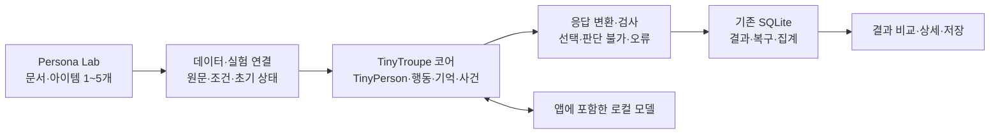

# TinyTroupe 기반 Persona Lab 구조 제안

이 문서는 전체 엔진 채택을 검토한 당시 제안이다. 현재 기본 실행은 제한된 Decision 구조이며, 적용 결과는 [구현 기록](../../IMPLEMENTATION.md)에 있다.

이 문서는 인물 상태·기억·사건·후속 질문을 확장하는 TinyTroupe 기반안이다. **현재 Decision 방식에 더 적합한 코어라는 결론은 유보한다.** 앞선 제안은 행동·대화 구조를 중심으로 판단했으며, 전용 Decision 모델과 전체 런타임 연결을 검증하지 않았다.

2026-10-06 구조 제안이다. 엔진 전환을 결정하거나 새 패키지를 설치한 상태는 아니다. 이전 [부분 이식 검토](CODE_REVIEW.md)는 현재 단발 평가의 유지 비용을 기준으로 판단했다. 그때 확인한 코드 문제는 이 기반안에서도 별도로 고친다.

## Decision 방식의 적용 조건

현재 Decision은 인물·상품·질문·선택지를 입력받아 선택 코드 또는 판단 불가를 반환한다. Qwen의 구조화 출력과 Julia 같은 전용 유한 선택 모델이 같은 결과 계약을 따른다. 자유 발화나 감정 생성은 필수 단계가 아니다.

TinyTroupe의 기본 `CognitiveActionModel`은 `action`과 `cognitive_state`를 요구한다. 실제 스키마를 분리해 검사하면 현재 Decision 객체는 이 두 필드가 없어서 거부된다. 따라서 로컬 모델 URL만 바꿔 연결하는 것으로 해결되지 않는다.

| 경로 | Decision 적용 | 확인한 범위 |
| --- | --- | --- |
| 기본 행동 생성 후 ResultsExtractor | 자유 반응을 만든 뒤 선택을 다시 추출한다. 전용 선택 모델만으로는 기본 흐름을 수행할 수 없다. | 소스 확인. 현재 모델로 전체 실행하지 않았다. |
| 사용자 정의 생성기에서 DecisionBackend 호출 | 선택을 `DECIDE` 행동으로 기록하고 `DONE`으로 끝낸다. 별도 발화·인지 상태·선택 재추출을 요구하지 않는다. | 실제 `act` 함수를 분리하고 주변 기능을 대체한 mock 검사에서 연결 지점을 확인했다. |
| 기존 Decision 실행기를 기본으로 유지 | 동일한 초기 조건의 선택·배치·집계를 수행한다. 인물 상태와 사건 관리의 확장 범위를 별도로 정한다. | 기존 모델·저장 검증은 있다. TinyTroupe와의 전체 통합은 아직 없다. |

분리 검사에서는 mock 판단 호출 1회로 선택 기록을 만들었다. 조건이 없으면 호출 없이 판단 불가가 되었고, 허용하지 않은 선택과 모델 오류는 성공으로 바꾸지 않았다. 인지 상태를 새로 생성하지 않았다. 기억·화면·재시도·초기화는 대체했으므로 전체 엔진 실행을 입증하지 않는다. 검사 코드는 `tools/probe_tiny_decision.py`다.

전용 Decision 모델을 연결할 때는 기존 배치 처리를 보존해야 한다. 인물마다 `decide`를 호출하는 연결만 만들면 Julia의 `decide_batch` 경로를 잃을 수 있다. 선택 모델이 생성하지 않은 사유와 감정을 결과 추출기로 보충해 원래 판단 근거처럼 표시하지 않는다.

따라서 기본 흐름은 **Decision 직접 실행 → 결과 계약 검사 → 저장·집계**로 둔다. TinyTroupe에는 인물 초기 상태와 사건·세션 관리 역할을 맡길 수 있다. 이 역할을 전체 TinyTroupe 기반으로 구현할 가치가 있는지는 실제 Decision 모델, 배치, 상태 격리와 저장 복구를 연결한 실행으로 확인한 뒤 결정한다.

[기본 출력 스키마](https://github.com/microsoft/TinyTroupe/blob/a6244b358a1fe1c71bf751f7ba0f8dfa368ec5a4/tinytroupe/agent/__init__.py#L47) · [생성기 주입과 행동 소비](https://github.com/microsoft/TinyTroupe/blob/a6244b358a1fe1c71bf751f7ba0f8dfa368ec5a4/tinytroupe/agent/tiny_person.py)

## 행동과 인지 상태가 쓰이는 곳

TinyTroupe에서 두 값은 마지막 보고서만을 위한 필드가 아니다. 다음 실행을 만드는 입력과 실행 명령으로 사용한다.

| 값 | 실제 소비 지점 | 현재 독립 선택 실험의 필요성 |
| --- | --- | --- |
| 행동 | TinyWorld가 TALK·SHOW·REACH_OUT을 다른 인물에게 전달한다. 정신 기능의 `process_action`은 등록한 처리를 실행한다. DONE은 해당 차례를 끝낸다. | 선택 코드와 완료 기록으로 줄일 수 있다. 다른 인물과 대화하거나 도구를 실행할 필요는 없다. |
| 목표·문맥·주의·감정 | `generate_agent_system_prompt`가 다음 프롬프트에 넣는다. `_update_cognitive_state`가 상태를 바꾸고, 상태를 바탕으로 관련 기억을 검색한다. | 모델이 매번 새로 생성할 필수 출력으로 둘 근거가 없다. 제공된 인물 속성·명시 조건·관측 기록을 입력으로 사용한다. |

[상태의 프롬프트 사용](https://github.com/microsoft/TinyTroupe/blob/a6244b358a1fe1c71bf751f7ba0f8dfa368ec5a4/tinytroupe/agent/tiny_person.py#L313) · [상태 갱신과 기억 검색](https://github.com/microsoft/TinyTroupe/blob/a6244b358a1fe1c71bf751f7ba0f8dfa368ec5a4/tinytroupe/agent/tiny_person.py#L1398) · [행동 전달](https://github.com/microsoft/TinyTroupe/blob/a6244b358a1fe1c71bf751f7ba0f8dfa368ec5a4/tinytroupe/environment/tiny_world.py#L523)

인지 상태는 연속 대화·사회적 상호작용에서 다음 반응에 영향을 준다. 현재의 같은 초기 조건·독립 상품 평가에 그 생성 과정을 의무로 넣으면 실험에 새 변수가 생긴다. 선택에 필요한 인물의 제공된 성향과 제약은 그대로 유지한다.

## 제한한 시나리오와 타입이 정해진 선택

사용자가 제시한 [typesafe-computer-use](https://github.com/awlevin/typesafe-computer-use)를 커밋 `44ca11f0935b021b73020825da054b5c92cc1288`로 받아 확인했다. 이 프로젝트는 코드가 관측 상태와 후보 목록을 구성하고 TypeSafe 모델이 목록의 키를 고르게 한다. 이후 처리는 정해진 핸들러가 수행한다. 기본 입력에 생성한 감정·주의 상태를 요구하지 않는다.

[base_state·Choice 구성](https://github.com/awlevin/typesafe-computer-use/blob/44ca11f0935b021b73020825da054b5c92cc1288/typesafe_computer_use/decide.py) · [정해진 행동 처리](https://github.com/awlevin/typesafe-computer-use/blob/44ca11f0935b021b73020825da054b5c92cc1288/typesafe_computer_use/actions.py)

우리 기본 경로에는 다음 분담이 적합하다.

| 요소 | 담당 | 예 |
| --- | --- | --- |
| 초기 상태 | 코드·제공된 자료 | 상품을 처음 제시한 상황, 가격, 명시한 구매 상한 |
| 허용 선택 | 질문·시나리오 정의 | 구매·보류·거절·판단 불가 |
| 선택 판단 | Decision 모델 | 동일 조건의 인물이 어느 선택을 하는지 |
| 다음 단계 | 코드의 전이 규칙 | 단발 평가 종료 또는 명시한 후속 사건 평가 |
| 종료·오류 | 코드 | 최대 단계 수, 조건 미제공, 허용값 밖의 응답, 실행 실패 |

첫 버전은 각 아이템·질문을 같은 초기 조건으로 평가한다. 여러 단계의 시나리오가 필요하면 사용 후 사건과 전이 규칙을 명시한다. 이전 응답이 임의의 새 감정·목표로 바뀌어 다음 판단에 섞이지 않게 한다.

모델에 규칙을 설명하는 것만으로 제한한 시나리오가 되지는 않는다. 허용 선택과 전이는 코드에서도 검사한다. 사실로 제공한 조건, 실험이 정한 제약, 모델 선택과 코드가 결정한 전이를 각각 기록한다. 가격 조건으로 선택을 미리 제거하는 변경은 실험 정의의 변경으로 남기며 모델의 가격 민감도처럼 해석하지 않는다.

선택 범위와 전이를 고정하면 실행 구조를 결정론적으로 만들 수 있다. 그 사실이 같은 입력에서 모델이 항상 같은 선택을 낸다는 보장은 아니다. 모델 버전·입력·선택지 순서·추론 설정을 고정한 뒤 응답 재현성을 따로 측정한다. 이 프로젝트의 confidence도 선택 모델의 지표이므로 실제 소비자의 구매 확률로 옮겨 부르지 않는다.

이 기준에서는 TinyTroupe의 행동·인지 상태 전체를 기본 경로에 요구할 필요가 없다. 현재 Decision 실행 구조를 먼저 사용하고, 구체적인 연속 시나리오에서 상태·기억 모듈의 필요성을 확인한다. TypeSafe의 컴퓨터 제어·외부 모델 API를 도입한 상태는 아니다.

아래 그림과 구성표는 행동·기억을 사용하는 확장안이다. 위 Decision 기본 경로와 구분한다.

## 코어로 사용할 부분

| TinyTroupe 구성 | 제품에서 맡길 역할 | 적용 범위 |
| --- | --- | --- |
| TinyPerson | 인물 정의, 반응 생성과 상태 | 기본 데이터의 제공된 속성으로 초기 인물을 만든다. 새 인물 생성기를 기본으로 사용하지 않는다. |
| 행동 생성기·기억 | 반응과 후속 질문의 문맥 | 독립 비교에서는 초기 상태를 복제한다. 후속 질문 세션에서는 해당 인물의 기록을 유지한다. |
| TinyWorld·사건 | 상품 제시, 명시한 상황과 시간 | 첫 버전은 독립 인물 평가를 유지한다. 사람끼리 대화하는 집단 실험은 별도 확장이다. |
| control·상태 직렬화 | 시뮬레이션 내부 상태와 재생 | 인물 상태를 보관한다. 제품 결과와 완료 지점의 원자적 저장은 기존 SQLite가 맡는다. |
| ResultsExtractor | 대화·반응에서 구조화 정보 추출 | 대화 확장에 사용한다. 기본 Decision 직접 경로에서는 선택을 모델로 재추출하지 않는다. |
| 클라이언트 등록 | 추론 모델 연결 | 앱의 localhost 모델로 연결한다. 기본 클라우드 설정을 사용하지 않는다. |

[TinyPerson](https://github.com/microsoft/TinyTroupe/blob/a6244b358a1fe1c71bf751f7ba0f8dfa368ec5a4/tinytroupe/agent/tiny_person.py)은 정의·반응·기억·상태 저장을 제공한다. [TinyWorld](https://github.com/microsoft/TinyTroupe/blob/a6244b358a1fe1c71bf751f7ba0f8dfa368ec5a4/tinytroupe/environment/tiny_world.py)는 사건과 실행 단계를 관리한다. [클라이언트 등록](https://github.com/microsoft/TinyTroupe/blob/a6244b358a1fe1c71bf751f7ba0f8dfa368ec5a4/tinytroupe/clients/__init__.py)은 사용자 정의 추론 연결을 허용한다. 이 확장 지점이 기반안의 근거다.

## 필요한 연결과 수정

1. **로컬 모델 연결.** TinyTroupe의 요청·응답 형식과 현재 llama.cpp의 JSON 스키마 호출을 연결한다. Qwen3-0.6B에서 행동·상태 응답을 안정적으로 생성하는지는 아직 확인하지 않았다. 단계 수, 토큰과 시간 상한을 정한다.
2. **오프라인 초기화.** 현재 상위 코드의 모듈 초기화는 OpenAI 또는 Azure 임베딩 객체를 만든다. 로컬 대화 클라이언트 등록만으로 모든 연결을 로컬로 바꿨다고 볼 수 없다. 초기화와 기억 검색의 연결을 명시적으로 바꾼다.
3. **비교 상태 격리.** 기존 판단의 독립성을 유지할 초기 상태 단위를 정한다. 다른 아이템·반복과 기억을 섞지 않는다. 질문 사이에 상태를 유지하는 실험은 기존 독립 질문 평가와 구분해 기록한다.
4. **결과 계약.** 발화와 추출한 선택을 함께 보관한다. 제공하지 않은 예산과 사용 이력을 원본 속성으로 만들지 않는다. 판단 불가와 실행 오류를 구분한다.
5. **제품 실행 관리.** TinyTroupe의 전역 설정과 인물 등록은 전용 작업 프로세스 안에서 관리한다. 현재 실험 저장, 재개, 오류 재시도와 보고서 집계는 보존한다.
6. **검증 수정.** 확인한 범주 번호 변환과 순서 배치 문제를 고친다. 종합 품질 점수를 구매 정확도로 표시하지 않는다.
7. **설치 묶음.** 엔진과 필요한 의존성을 앱 안에 포함한다. 버전을 고정하고 MIT 고지를 보존한다. 사용자의 첫 화면에 설치·연결 단계를 추가하지 않는다.

오프라인 초기화의 근거는 [상위 모듈의 임베딩 설정](https://github.com/microsoft/TinyTroupe/blob/a6244b358a1fe1c71bf751f7ba0f8dfa368ec5a4/tinytroupe/__init__.py#L417)이다. [ResultsExtractor](https://github.com/microsoft/TinyTroupe/blob/a6244b358a1fe1c71bf751f7ba0f8dfa368ec5a4/tinytroupe/extraction/results_extractor.py)는 발화에서 정보를 추출할 때 모델을 다시 호출한다. 따라서 현재의 한 판단당 단발 호출과 비용·오류 경계가 다르다.

## 전환 전에 확인할 실행

기본 패널의 소수 인물과 아이템 1개·2개로 전체 흐름을 먼저 실행한다. 같은 입력을 현재 실행기와 TinyTroupe 기반 실행기에서 비교한다.

| 확인 항목 | 전환 기준 |
| --- | --- |
| 실제 로컬 실행 | 대화·추출·기억 관련 요청이 앱의 로컬 자원 안에서 처리된다. |
| 반응과 추출 | 출력 계약을 지키고, 원래 발화·선택·오류를 추적할 수 있다. |
| 입력 충실성 | 원문에 없는 예산·경험을 제공된 사실로 취급하지 않는다. |
| 비교 격리 | 이전 아이템의 반응이 다음 아이템의 초기 상태에 남지 않는다. |
| 저장과 복구 | 중단·재개와 오류 재시도에서 결과가 중복되지 않는다. |
| 실행 자원 | 인물·아이템당 호출 수, 시간, 메모리와 앱 크기를 측정한다. |

이 실행은 엔진 연결과 제품 요구를 확인한다. 실제 구매 행동 정확도 검증은 [BIWA 실험 설계](https://wiki.biwa.dedyn.io/#personal-wiki/persona-lab-experiment-design)의 별도 작업이다.
